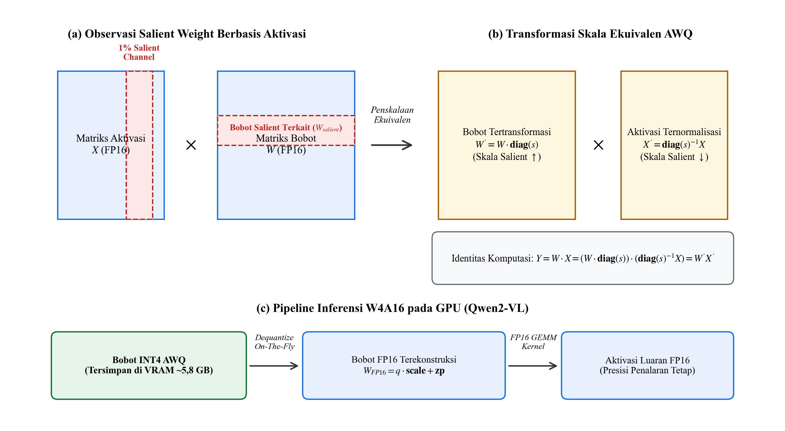

# 2. TINJAUAN PUSTAKA

## 2.1 Penelitian Terdahulu

Telaah literatur terhadap penelitian terdahulu menunjukkan pergeseran paradigma yang jelas dalam pemrosesan data katalog produk perdagangan digital. Pendekatan awal yang berfokus pada ekstraksi atribut berbasis representasi teks murni telah berkembang menuju integrasi penambatan visual multimodal guna menangkap keterkaitan spasial antara deskripsi produk dan citra kemasan. Perkembangan lanjutan menunjukkan keberhasilan modul deteksi objek dan sistem OCR terdedikasi dalam mengekstraksi teks pada permukaan kemasan ritel fisik secara deterministik. Pada tahap kontemporer, kemunculan model fondasi multimodal beresolusi dinamis dan agen cerdas berbasis penalaran bertahap memperluas kapabilitas audit visual dalam memverifikasi kepatuhan atribut produk berskala besar. Pemetaan sistematis terhadap delapan penelitian terdahulu yang relevan dirangkum pada Tabel 2.1.

**Tabel 2.1 Penelitian Terdahulu**

| No | Peneliti dan Tahun | Objek Penelitian | Metode | Hasil Penelitian | Perbedaan |
|:---:|:---|:---|:---|:---|:---|
| 1 | Huma, Fanggidae, Rumlaklak, dan Triwahyuadi (2026) | Kemasan pangan olahan | YOLOv8 dan PaddleOCR | Akurasi ekstraksi 84,20% | Menguji kemasan kosmetik permukaan lengkung tiga atribut dan membandingkannya dengan MLLM. |
| 2 | Liu dkk. (2026) | Citra perdagangan digital permukaan lengkung | DBNet++ dan SVTR | F-measure 88,70% pada permukaan lengkung | Mengintegrasikan detektor objek spasial dan sistem verifikasi aturan katalog terpadu. |
| 3 | Kumar dkk. (2026) | Katalog produk ritel perdagangan digital | Agentic MLLM ReAct | Akurasi audit 98,20% dan penambahan kelengkapan atribut 90,40% | Menguji komparasi langsung terhadap alur konvensional melalui uji statistik inferensial formal. |
| 4 | Richo (2025) | Kemasan ritel | YOLOv11m dan PaddleOCR | mAP@50 98,44% dan akurasi verifikasi 97,42% | Memverifikasi multi-atribut katalog dengan partisi data bebas bocor antar-merek. |
| 5 | Shukla dan Sonalkar (2025) | Atribut terperinci perdagangan digital | MLLM Zero-Shot | Akurasi makro 86,10% turun ke 61,80% pada teks mikro | Membandingkan modul inspeksi lokal dinamis terhadap detektor spasial fisik terpisah. |
| 6 | Wang dkk. (2024) | Dokumen visual umum | Qwen2-VL Dynamic Resolution | Akurasi DocVQA 95,70% | Menguji adaptasi model penalaran pada citra fisik kemasan kosmetik ritel berlatar studio. |
| 7 | Wu, Bouyarmane, dan Tutar (2023) | Pasangan produk ritel berjumlah 2,3 juta | Catalog Phrase Grounding | mAP 68,50% melokalisasi frasa atribut | Menuntaskan pembacaan teks karakter mikro dan kepatuhan nomor izin edar BPOM. |
| 8 | Yang dkk. (2022) | Produk MAVE berjumlah 2,2 juta | Multimodal Sequence Tagging | F1-Score ekstraksi atribut 82,40% | Mencakup verifikasi silang fisik kemasan permukaan lengkung berlatar studio terstandardisasi. |

Sintesis terhadap Tabel 2.1 memperlihatkan evolusi metodologis yang berkesinambungan dari model sekuensial berbasis teks menuju pemodelan spasial multimodal dan penalaran agen cerdas otonom. Pada tahap awal rekayasa visi komputer, kolaborasi antara detektor spasial dan modul OCR terbukti efektif mengekstraksi teks spesifikasi pada kemasan produk ritel maupun pangan olahan (Huma, Fanggidae, Rumlaklak, dan Triwahyuadi, 2026). Meskipun demikian, efektivitas metode deteksi spasial konvensional tersebut umumnya diuji pada kemasan datar dengan orientasi horizontal yang seragam. Ketika dihadapkan pada produk kosmetik, kelengkungan bidang wadah botol dan toples menimbulkan distorsi optis non-linear yang menuntut pemodelan geometri khusus. Menjawab kendala deformasi tersebut, Liu dkk. (2026) membuktikan bahwa adaptasi arsitektur DBNet++ dan rekognisi sekuensial SVTR mampu mempertahankan ketahanan pembacaan karakter pada permukaan lengkung hingga mencapai nilai *F-measure* sebesar 88,70%.

Perkembangan berikutnya bergerak melampaui sekadar ekstraksi teks fisik, yakni menghubungkan entitas visual kemasan dengan struktur atribut katalog niaga elektronik. Dalam hal ini, Yang dkk. (2022) menginisiasi penandaan sekuensial multimodal berbasis representasi gabungan teks judul dan citra produk guna mengekstraksi atribut bernilai tinggi pada skala jutaan data. Kerangka penambatan visual ini kemudian disempurnakan oleh Wu, Bouyarmane, dan Tutar (2023) melalui mekanisme penambatan frasa visual teks yang secara eksplisit memetakan frasa deskripsi katalog ke koordinat wilayah kotak pembatas objek pada kemasan ritel. Integrasi representasi lintas modalitas ini meletakkan fondasi penting bagi verifikasi otomatis, sebab ketidakcocokan antara teks klaim katalog dan wujud visual kemasan dapat diidentifikasi secara langsung melalui relasi semantik antarmodalitas.

Pada perkembangan teknologi terkini, kemunculan model fondasi multimodal dan paradigma agen otonom membuka kapabilitas baru dalam audit katalog produk digital. Kumar dkk. (2026) membuktikan bahwa pemanfaatan agen multimodal berbasis siklus ReAct mampu meningkatkan kelengkapan atribut produk hingga 90,40% dan mencatatkan akurasi audit sebesar 98,20% melalui koordinasi dinamis antar-alat bantu visual. Di sisi lain, Wang dkk. (2024) mendemonstrasikan bahwa arsitektur Qwen2-VL dengan mekanisme resolusi dinamis mencapai akurasi 95,70% pada pemahaman dokumen visual kompleks tanpa terdistorsi oleh rasio aspek masukan. Meskipun demikian, Shukla dan Sonalkar (2025) mengidentifikasi batasan mendasar model fondasi multimodal saat dihadapkan pada karakter teks berukuran mikro pada kemasan fisik produk, di mana akurasi pembacaan mengalami penurunan tajam dari 86,10% menjadi 61,80%.

Berdasarkan telaah kritis terhadap penelitian terdahulu, ditemukan celah penelitian yang belum terselesaikan. Sebagian besar penelitian menguji sistem verifikasi pada kemasan datar atau dokumen pindaian ideal, belum mengintegrasikan detektor objek YOLOv11 dan mesin PaddleOCR secara komparatif melawan model penalaran otonom Agentic MLLM Qwen2-VL, serta belum mengevaluasi performa model menggunakan pengujian statistik inferensial formal pada produk kosmetik berkemasan lengkung. Penelitian ini hadir untuk menutup celah tersebut dengan membandingkan kedua paradigma kecerdasan buatan secara empiris pada dataset katalog Sociolla berbasis partisi bebas kebocoran merek.

## 2.2 Kemasan Kosmetik

Katalog kosmetik digital pada platform niaga elektronik seperti Sociolla mengelola ribuan data spesifikasi produk resmi yang memuat informasi teks dan citra kemasan fisik. Secara fisik, produk kosmetik memiliki variasi geometri kemasan yang beragam, meliputi botol silindris, toples bundar, tabung plastik fleksibel, dispenser pompa, hingga wadah padat. Ragam geometri ini menampung berbagai kategori sediaan produk, seperti sediaan cair (toner, serum, micellar water), emulsi atau krim (pelembap, tabir surya), gel, losion, hingga serbuk padat.

Karakteristik visual kemasan kosmetik tampak depan menyajikan tiga atribut utama yang menjadi fokus identifikasi konsumen dan kurasi katalog, yaitu nama merek dagang, volume atau berat isi bersih, dan tipe sediaan produk. Merujuk pada Undang-Undang Perlindungan Konsumen Nomor 8 Tahun 1999 serta Peraturan BPOM Nomor 23 Tahun 2019 tentang Persyaratan Teknis Penandaan Kosmetika, setiap produk yang beredar wajib mencantumkan penandaan yang benar, jelas, dan tidak menyesatkan pada panel utama tampak depan:
1. Nama Kosmetika: Memuat nama produk dan nama merek dagang yang telah terdaftar resmi pada sistem notifikasi BPOM.
2. Isi Bersih atau Netto: Dinyatakan secara tegas dalam satuan metrik volume mililiter atau liter untuk sediaan cair, serta satuan massa gram atau miligram untuk sediaan padat dan semi-padat.
3. Bentuk Sediaan: Penjelasan fungsi atau wujud fisik produk yang membedakan peruntukan penggunaannya.

Posisi ketiga atribut label dan wujud fisik kemasan disajikan pada Gambar 2.1.

**Gambar 2.1 Karakteristik Fisik Kemasan dan Label Atribut**

Gambar 2.1 memperlihatkan posisi fisik ketiga atribut utama pada kemasan kosmetik tampak depan, di mana nama merek diletakkan pada bagian atas, jenis sediaan produk pada bagian tengah, dan keterangan isi bersih berada pada bagian bawah label. Pada saat yang sama, Gambar 2.1 memperlihatkan tantangan pantulan cahaya studio pada permukaan wadah plastik dan kaca yang menghasilkan area kilap luminansi tinggi sehingga berpotensi menutupi karakter teks label.

Selain pantulan cahaya studio, kelengkungan fisik botol silindris menyebabkan baris teks label tampak melengkung secara optis terhadap sudut tangkapan kamera, serta ukuran huruf mikro pada informasi netto memiliki ketebalan goresan hanya beberapa piksel pada resolusi standar katalog digital. Ketidaksesuaian antara teks klaim katalog dan kondisi fisik kemasan merupakan pelanggaran terhadap hak konsumen dan regulasi BPOM. Oleh karena itu, label kemasan fisik yang tampak pada citra katalog diposisikan sebagai rujukan hukum dan faktual primer atau *ground truth*. Sistem verifikasi otomatis bertugas mencocokkan data entri teks katalog terhadap data visual kemasan fisik guna memastikan kepatuhan penandaan sebelum produk ditayangkan.

## 2.3 Citra Digital

Citra digital didefinisikan sebagai fungsi intensitas cahaya dua dimensi f(x, y), di mana $x$ dan $y$ menyatakan koordinat spasial bidang citra, sedangkan amplitudo nilai f pada sembarang koordinat (x, y) menyatakan intensitas kecerahan atau derajat keabuan citra pada titik tersebut (Gonzalez dan Woods, 2018). Menurut Putra (2010), suatu citra visual diklasifikasikan sebagai citra digital apabila nilai koordinat spasial $x, y$ serta nilai amplitudo intensitas f seluruhnya bernilai diskret dan berhingga. Ditinjau melalui representasi komputasi, citra digital dinyatakan dalam susunan matriks dua dimensi berukuran M × N, di mana $M$ menyatakan jumlah baris dan $N$ menyatakan jumlah kolom, sebagaimana dirumuskan pada Persamaan (2.1):

Setiap elemen diskret pada perpotongan baris dan kolom pada Persamaan (2.1) disebut sebagai elemen gambar atau piksel. Pada citra berwarna standar, representasi visual disusun berdasarkan model warna aditif RGB. Model ini merepresentasikan citra sebagai matriks tiga dimensi berukuran $M \times N \times 3$ yang tersusun atas tiga kisi kanal warna primer, yaitu kanal merah, kanal hijau, dan kanal biru. Setiap elemen piksel pada masing-masing kanal warna memiliki kedalaman kuantisasi 8-bit, sehingga menyimpan variasi intensitas warna sebanyak $2^8$ atau 256 derajat nilai diskret dengan rentang integer antara 0 hingga 255.

Dalam konteks fotografi produk katalog perdagangan digital Sociolla, citra kemasan kosmetik diambil di lingkungan studio dengan pencahayaan buatan berlatar putih bersih dengan dimensi standar $800 \times 800$ piksel. Interaksi berkas cahaya studio pada permukaan wadah kosmetik berbahan plastik kilap atau kaca menghasilkan fenomena pantulan spekular. Secara numerik pada matriks piksel, pantulan ini memicu saturasi intensitas maksimal pada ketiga kanal warna secara serentak dengan nilai $R = G = B = 255$. Saturasi intensitas tersebut menghilangkan detail gradien tekstur dan kontur goresan huruf teks label mikro kemasan fisik, seperti nama produk dan informasi netto. Oleh karena itu, pemahaman karakteristik matematis citra digital menjadi dasar perancangan tahapan praproses penstabilan luminansi dan perbaikan kontras lokal adaptif sebelum ekstraksi fitur dilakukan oleh model pembelajaran mendalam.

Representasi sistem koordinat spasial dan struktur matriks piksel diskret citra kemasan disajikan pada Gambar 2.2.

**Gambar 2.2 Representasi Citra Digital dalam Matriks Piksel**

Gambar 2.2 memperlihatkan pemetaan citra kemasan kosmetik ke dalam sistem koordinat spasial diskret. Panel (a) menampilkan potongan citra label kemasan asli katalog Sociolla dengan penanda wilayah target pembesaran. Panel (b) memperlihatkan kisi piksel visual pembentuk kontur huruf teks, sedangkan Panel (c) menyajikan representasi matriks nilai intensitas kecerahan diskret f(x, y) berskala 8-bit yang membedakan goresan huruf bernilai intensitas rendah dari permukaan wadah bernilai intensitas tinggi.

## 2.4 Praproses Citra

Praproses citra merupakan tahap awal pengolahan data visual yang bertujuan memperbaiki kualitas data citra mentah, menekan gangguan distorsi yang tidak diinginkan, serta menonjolkan fitur visual penting agar model pembelajaran mesin dapat mengekstrak informasi secara optimal (Sonka, Hlavac, dan Boyle, 1993). Dalam visi komputer, data citra mentah yang diperoleh dari sensor atau kamera umumnya masih memiliki variasi pencahayaan, derau latar belakang, dan perbedaan dimensi yang belum seragam. Sebagaimana ditegaskan oleh Stojnev dan Stojnev Ilić (2020), praproses data citra berfungsi mereduksi derau dan meningkatkan kualitas representasi masukan sehingga menghasilkan presisi lokalisasi dan akurasi prediksi yang lebih tinggi pada model klasifikasi maupun deteksi objek.

Pada kemasan kosmetik, citra katalog digital menghadapi kendala berupa pantulan cahaya spekular pada permukaan wadah kaca atau plastik, teks berukuran mikro pada label isi bersih, serta orientasi kemasan yang bervariasi. Untuk mempersiapkan citra agar siap diproses oleh detektor objek YOLOv11 dan mesin PaddleOCR, diterapkan rangkaian tahapan praproses terstruktur sebagaimana disajikan pada Gambar 2.3.

**Gambar 2.3 Tahapan Pengolahan Citra Digital**

Bagan alir pada Gambar 2.3 memperlihatkan alur praproses citra kemasan kosmetik yang mencakup enam tahapan berurutan, dimulai dari penerimaan citra mentah, reduksi derau dengan penapisan bilateral, pemisahan pantulan kilap pada ruang warna HLS, penajaman adaptif tepi karakter teks, perbaikan kontras lokal adaptif CLAHE, hingga standardisasi kanvas *letterbox padding* berukuran 640 × 640 piksel.

Peningkatan kontras teks kemasan tidak dapat dilakukan secara langsung pada kanal warna RGB asli karena ketiga kanal tersebut memiliki korelasi intensitas yang saling terikat. Manipulasi langsung pada kanal RGB berpotensi mengubah warna asli produk dan merusak identitas merek dagang. Oleh karena itu, citra terlebih dahulu ditransformasikan ke dalam ruang warna perseptual CIE L*a*b* guna memisahkan komponen intensitas luminansi L* secara ortogonal dari dua komponen krominans a* dan b*. Merujuk pada standar kolorimetri CIE, konversi nilai koordinat (L*, a*, b*) dari ruang tristimulus (X, Y, Z) terhadap titik referensi putih standar (X_n, Y_n, Z_n) dirumuskan pada Persamaan (2.2) dan Persamaan (2.3):

dengan fungsi pemetaan non-linear f(t) yang dirumuskan sebagai berikut:

Setelah komponen luminansi L* terisolasi, perbaikan kontras lokal diterapkan menggunakan metode *Contrast Limited Adaptive Histogram Equalization* atau CLAHE (Zuiderveld, 1994). CLAHE bekerja dengan membagi kanvas citra menjadi kisi-kisi ubin lokal kontekstual berukuran $M_{\text{tile}} \times N_{\text{tile}}$ seperti kisi 8 × 8 ubin, lalu melakukan perataan histogram secara mandiri pada setiap blok. Untuk mencegah penguatan derau visual pada area latar belakang kemasan yang polos, distribusi histogram lokal dipangkas berdasarkan ambang batas klip β sesuai formulasi Persamaan (2.4):

Piksel yang melampaui batas ambang β didistribusikan kembali secara merata ke seluruh kelas intensitas, dan artefak garis batas antar-ubin dieliminasi menggunakan interpolasi bilinear.

Tahap akhir praproses adalah penyeragaman dimensi citra menuju ukuran target W_t × H_t sebesar 640 × 640 piksel dan normalisasi rentang nilai piksel ke dalam skala 0 hingga 1. Penyeragaman dimensi pada deteksi kemasan tidak boleh menggunakan pengubahan ukuran langsung secara *direct resize* yang meregangkan gambar, karena perubahan rasio aspek akan mendistorsi bentuk fisik botol dan geometri teks label. Oleh sebab itu, diterapkan teknik *letterbox padding* yang mempertahankan rasio aspek asli dengan menyisipkan batas abu-abu netral pada sisi yang lebih pendek. Faktor skala proporsional s serta offset pergeseran pusat (d_x, d_y) dari dimensi citra awal (w₀, h₀) dihitung melalui Persamaan (2.5):

Penyusutan resolusi dilakukan dengan interpolasi area piksel untuk mempertahankan ketajaman garis huruf kecil pada label netto. Parameter affine [s, d_x, d_y] disimpan untuk memetakan kembali koordinat *bounding box* hasil deteksi pada kanvas letterbox $(x′, y′)$ ke koordinat piksel citra kemasan asli (x_orig, y_orig) melalui Persamaan (2.6):

## 2.5 Deep Learning

*Deep learning* merupakan sub-bidang dari *machine learning* dan bagian dari ranah *artificial intelligence* yang memanfaatkan arsitektur jaringan saraf tiruan berlapis banyak untuk mempelajari representasi data secara hierarkis (LeCun dkk., 2015). Istilah *deep* merujuk pada keberadaan lapisan tersembunyi yang berjumlah banyak di antara lapisan masukan dan lapisan keluaran jaringan saraf (Goodfellow dkk., 2016). Struktur multi-lapis ini mentransformasikan data masukan mentah secara bertingkat melalui serangkaian fungsi non-linear menuju representasi abstraksi tingkat tinggi (Deng dan Yu, 2014). Posisi hierarkis *deep learning* dalam ranah kecerdasan buatan disajikan pada Gambar 2.4.

**Gambar 2.4 Hubungan Artificial Intelligence, Machine Learning, dan Deep Learning**

Gambar 2.4 mengilustrasikan relasi himpunan bersarang yang menegaskan bahwa *deep learning* merupakan spesialisasi dari *machine learning*, di mana keduanya bernaung di bawah payung disiplin *artificial intelligence*. Jaringan saraf tiruan pada *deep learning* tersusun atas simpul komputasi yang saling terhubung melintasi lapisan masukan, deretan lapisan tersembunyi, hingga lapisan keluaran akhir. Struktur berlapis ini memungkinkan jaringan memproses variasi data citra berdimensi tinggi secara adaptif.

Meskipun *deep learning* berada dalam naungan *machine learning*, kedua paradigma tersebut memiliki perbedaan mendasar pada metode ekstraksi fitur visual (Chollet, 2021). Perbandingan alur kerja rekayasa fitur antara pembelajaran mesin tradisional dan pembelajaran mendalam disajikan pada Gambar 2.5.

**Gambar 2.5 Perbandingan Alur Rekayasa Fitur Tradisional dan Deep Learning**

Bagan alir pada Gambar 2.5 memperlihatkan perbedaan alur komputasi kedua paradigma pada klasifikasi objek kemasan kosmetik. Pada pembelajaran mesin tradisional, alur kerja terpecah menjadi dua tahap terpisah yang menuntut campur tangan perancang manusia untuk mengekstraksi fitur visual manual (*feature extraction*) sebelum diumpankan ke algoritma pengklasifikasi (*classification*) guna menentukan kategori luaran produk. Keterbatasan utama pendekatan ini terletak pada ketergantungannya terhadap keahlian pakar serta kerentanan performa saat menghadapi variasi pencahayaan dan distorsi geometri kemasan. Sebaliknya, paradigma *deep learning* mengintegrasikan ekstraksi representasi fitur visual dan proses klasifikasi (*feature extraction + classification*) ke dalam satu arsitektur jaringan saraf mendalam secara terpadu (*end-to-end*) langsung dari data piksel masukan kemasan menuju prediksi kategori luaran *skincare*.

Prinsip kerja *deep learning* bertumpu pada kemampuan pembentukan hierarki representasi bertingkat secara mandiri (Alzubaidi dkk., 2021). Lapisan awal jaringan mempelajari fitur primitif lokal berfrekuensi spasial tinggi seperti orientasi garis tepi, titik sudut kontur, dan gradien intensitas luminansi. Lapisan perantara menggabungkan fitur primitif tersebut menjadi susunan tekstur permukaan wadah, pola kurvatur botol, dan kontur bentuk kemasan kosmetik. Pada lapisan terdalam, jaringan menyusun abstraksi semantik global yang komprehensif guna mengenali entitas objek utuh serta membedakan karakter teks label secara invarian terhadap variasi skala, rotasi, maupun distorsi perspektif.

Proses optimasi model *deep learning* dilakukan dengan meminimalkan fungsi kerugian melalui algoritma propagasi balik berbasis aturan rantai kalkulus diferensial parsial (Goodfellow dkk., 2016). Galat prediksi dihitung pada keluaran akhir jaringan terhadap target acuan, kemudian gradien kesalahan dipropagasikan mundur melintasi setiap lapisan guna memperbarui matriks bobot sinapsis menggunakan algoritma optimasi berbasis gradien adaptif seperti AdamW (Loshchilov dan Hutter, 2019). Pembelajaran representasi otomatis ini mengeliminasi bias subjektif perancangan fitur manual dan menjadi fondasi utama bagi model visi komputer seperti YOLOv11 dan PaddleOCR dalam menganalisis citra kemasan kosmetik katalog yang kompleks akibat pantulan cahaya studio dan variasi tipografi.

## 2.6 Jaringan Konvolusi

*Convolutional Neural Network* atau CNN merupakan arsitektur jaringan saraf tiruan khusus yang dirancang untuk memproses data berstruktur kisi-kisi spasial dua dimensi seperti citra digital (Goodfellow dkk., 2016). Berbeda dengan jaringan saraf tiruan konvensional *multilayer perceptron* yang menghubungkan seluruh simpul komputasi secara penuh, keunggulan arsitektural CNN bertumpu pada dua mekanisme utama: bobot bersama (*parameter sharing*) dan konektivitas lokal (*sparse connectivity*). Kedua mekanisme tersebut mereduksi jumlah parameter bobot secara drastis serta mempertahankan sifat invariansi translasi terhadap pergeseran posisi objek visual pada citra kemasan.

Struktur arsitektur CNN terbagi menjadi dua blok tahapan pemrosesan terpadu: tahap pembelajaran fitur (*feature learning*) dan tahap klasifikasi (*classification*) (LeCun dkk., 2015). Diagram arsitektur umum *Convolutional Neural Network* beserta komponen komputasinya disajikan pada Gambar 2.6.

**Gambar 2.6 Arsitektur Jaringan Saraf Tiruan Konvolusi**

Gambar 2.6 memperlihatkan alur kerja terstruktur CNN yang memetakan citra masukan berdimensi $W \times H \times C$ menuju prediksi kategori kelas objek. Blok pembelajaran fitur bertugas mengekstraksi representasi visual secara bertingkat melalui perulangan lapisan konvolusi, fungsi aktivasi non-linear, dan lapisan *pooling*. Representasi spasial yang telah tereduksi kemudian diratakan (*flatten*) menjadi vektor satu dimensi pada blok klasifikasi sebelum diproses oleh lapisan terhubung penuh (*fully connected*) dan dinormalisasi oleh fungsi *softmax*.

Operasi inti pada tahap pembelajaran fitur adalah konvolusi dua dimensi. Secara matematis, operasi konvolusi diskret antara matriks citra masukan $I$ dan kernel penapis K berukuran $(2m+1) \times (2n+1)$ dirumuskan pada Persamaan (2.7):

di mana (i, j) menyatakan indeks koordinat spasial piksel keluaran. Dimensi spasial keluaran peta fitur $O$ setelah operasi konvolusi dipengaruhi oleh dimensi masukan $W$, ukuran kernel penapis K, ketebalan batas *padding* P, serta langkah pergeseran *stride* $S$, sebagaimana dinyatakan pada Persamaan (2.8):

Hasil operasi linier konvolusi kemudian ditransformasikan melalui fungsi aktivasi non-linear guna memperluas kapasitas representasi jaringan terhadap pola visual yang kompleks (Nair dan Hinton, 2010). Fungsi *Rectified Linear Unit* atau ReLU merupakan fungsi aktivasi standar yang memangkas nilai aktivasi negatif menjadi nol sesuai Persamaan (2.9):

Pada arsitektur detektor modern seperti YOLOv11, fungsi aktivasi disempurnakan menggunakan varian *Sigmoid-Weighted Linear Unit* atau SiLU guna menghasilkan turunan gradien yang kontinu dan mencegah terjadinya fenomena neuron mati (*dead neurons*) (Elfwing dkk., 2018), sebagaimana dirumuskan pada Persamaan (2.10):

Untuk mereduksi dimensi spasial peta fitur, mempercepat efisiensi komputasi, dan mempertahankan sifat invariansi translasi terhadap distorsi posisi label kemasan, diterapkan lapisan *pooling* (Goodfellow dkk., 2016). Operasi *Max Pooling* mengambil nilai intensitas kecerahan tertinggi pada jendela wilayah spasial lokal $\Omega$ dengan langkah *stride* s, sebagaimana dinyatakan pada Persamaan (2.11):

Setelah melewati rangkaian lapisan konvolusi dan *pooling*, peta fitur dua dimensi diratakan (*flatten*) menjadi vektor fitur satu dimensi $x$. Vektor tersebut kemudian dihubungkan ke lapisan terhubung penuh (*fully connected layer*) melalui transformasi perkalian matriks bobot $W$ dan penambahan vektor bias b (Goodfellow dkk., 2016) sesuai formulasi Persamaan (2.12):

Pada tahap luaran akhir, vektor logit $z$ dikonversikan menjadi distribusi nilai probabilitas untuk setiap kategori kelas atribut produk menggunakan fungsi normalisasi *Softmax*, sebagaimana dirumuskan pada Persamaan (2.13):

di mana $C$ menyatakan total kelas klasifikasi objek kemasan. Mekanisme komputasi hierarkis ini menjadi tulang punggung arsitektural bagi modul *backbone* pada detektor objek YOLOv11 dan modul pengekstraksi fitur visual pada sistem PaddleOCR.

## 2.7 Deteksi Objek

Deteksi objek merupakan cabang visi komputer yang menggabungkan dua tugas komputasi secara simultan: lokalisasi wilayah objek dan klasifikasi kategori objek. Berbeda dengan klasifikasi citra sederhana yang hanya memprediksi satu label global untuk satu citra utuh, deteksi objek mampu menentukan letak koordinat spasial beberapa objek sekaligus melalui representasi *bounding box*.

Secara representasional, sebuah kotak pembatas didefinisikan oleh empat parameter kontinu: $(x_c, y_c, w, h)$, di mana $(x_c, y_c)$ menyatakan koordinat pusat kotak, sedangkan w dan h menyatakan lebar dan tinggi kotak pembatas. Setiap kotak pembatas disertai dengan *confidence score* serta vektor probabilitas distribusi kelas objek.

Tingkat ketepatan lokalisasi kotak pembatas prediksi $B_1$ terhadap kotak pembatas acuan *ground truth* $B_2$ diukur menggunakan metrik *Intersection over Union* atau IoU. IoU menghitung rasio luas irisan persekutuan terhadap luas gabungan dari kedua kotak pembatas, sebagaimana dirumuskan pada Persamaan (2.14):

Nilai IoU bernilai antara 0 untuk kondisi tanpa tumpang tindih hingga 1 untuk tumpang tindih sempurna. Ambang batas IoU seperti $\text{IoU} \ge 0{,}50$ digunakan sebagai kriteria verifikasi penentuan keberhasilan lokalisasi label kemasan.

## 2.8 Algoritma YOLO

*You Only Look Once* atau YOLO merupakan algoritma deteksi objek berbasis jaringan saraf tiruan yang dikembangkan oleh Joseph Redmon pada tahun 2016 (Redmon dkk., 2016). Berbeda dengan sistem pendeteksi objek dua tahap (*two-stage detector*) seperti R-CNN yang memisahkan proses pembuatan usulan wilayah (*region proposal*) dan klasifikasi ke dalam modul terpisah, YOLO memperlakukan deteksi objek sebagai satu masalah regresi tunggal (*single regression problem*) langsung dari data piksel citra menuju prediksi koordinat kotak pembatas dan probabilitas kelas objek (Satria, 2025). Pendekatan *single-shot* ini memungkinkan model mengevaluasi konteks spasial citra secara menyeluruh (*global context*) dalam satu lintasan inferensi dan menghasilkan kecepatan pemrosesan tinggi secara *real-time* (Fernando, 2024).

Mekanisme kerja deteksi YOLO bertumpu pada pembagian kanvas citra masukan menjadi kisi-kisi spasial berukuran $S \times S$ (Redmon dkk., 2016). Apabila titik koordinat pusat suatu objek jatuh ke dalam suatu sel grid tertentu, maka sel grid tersebut bertanggung jawab secara tunggal untuk mendeteksi keberadaan objek tersebut. Ilustrasi alur kerja mekanisme deteksi sistem YOLO disajikan pada Gambar 2.7.

**Gambar 2.7 Ilustrasi Mekanisme Deteksi Sistem YOLO**

Berdasarkan alur kerja pada Gambar 2.7, setiap sel grid memprediksi sejumlah $B$ kotak pembatas (*bounding boxes*) beserta nilai skor keyakinan (*confidence score*) untuk masing-masing kotak pembatas. Nilai skor keyakinan mencerminkan tingkat kepastian model bahwa kotak tersebut memuat objek serta tingkat ketepatan dimensi kotak yang diprediksi terhadap objek acuan *ground truth*, sebagaimana dirumuskan pada Persamaan (2.15):

Jika tidak ada objek pada sel grid, nilai skor keyakinan bernilai nol. Sebaliknya, jika terdapat objek di dalam sel, skor keyakinan bernilai setara dengan nilai *Intersection over Union* (IoU) antara kotak prediksi dan kotak acuan *ground truth*. Selain kotak pembatas, setiap sel memprediksi distribusi probabilitas kelas objek bersyarat $\Pr(\text{Class}_i \mid \text{Object})$. Pada tahap akhir evaluasi, perkalian antara skor keyakinan individual dan probabilitas kelas menghasilkan skor keyakinan kelas spesifik, kemudian kandidat kotak pembatas yang tumpang tindih disaring menggunakan eliminasi maksimum non-lokal (*Non-Maximum Suppression* atau NMS) guna menyisakan deteksi akhir yang paling presisi (Redmon dkk., 2016). Prinsip dasar *single-stage* inilah yang mendasari evolusi arsitektur YOLO hingga generasi mutakhir YOLOv11.

## 2.9 YOLOv11

YOLO merupakan kerangka kerja deteksi objek satu tahap yang memproses citra secara langsung dari piksel masukan menuju koordinat kotak pembatas dan kelas objek dalam satu lintasan inferensi tunggal (Redmon dkk., 2016). Generasi terbaru arsitektur ini, YOLOv11, dirancang oleh Ultralytics (2024) dengan memperkenalkan optimasi efisiensi parameter dan pemodelan fitur multiskala. Diagram arsitektur jaringan YOLOv11 disajikan pada Gambar 2.8.

**Gambar 2.8 Arsitektur Jaringan YOLOv11**

Gambar 2.8 memperlihatkan struktur modular YOLOv11 yang terdiri atas tiga komponen utama: *Backbone*, *Neck*, dan *Head*. Pada *Backbone*, modul C3k2 digunakan untuk mengekstrak fitur spasial kemasan secara efisien. Peta fitur kemudian diagregasi pada lapisan leher menggunakan modul SPPF dan jaringan piramida fitur terpadu, sebelum diteruskan ke kepala deteksi *anchor-free* untuk memprediksi kotak pembatas tiga atribut kemasan: `brand_name`, `net_content`, dan `product_type`.

Pelatihan model deteksi objek YOLOv11 mengoptimalkan fungsi kerugian terpadu L_YOLO yang mengintegrasikan galat regresi kotak pembatas dan galat klasifikasi kategori, sebagaimana dirumuskan pada Persamaan (2.16):

Komponen L_CIoU mengoptimalkan keselarasan spasial kotak pembatas dengan memperhitungkan jarak pusat Euclidean, rasio aspek proporsional, dan tumpang tindih luas irisan. Komponen L_DFL atau *Distribution Focal Loss* memodelkan batas koordinat sebagai distribusi probabilitas kontinu untuk menangani ketidakpastian tepi label kemasan yang kabur, sedangkan L_BCE mengevaluasi ketepatan prediksi kelas objek atribut kosmetik.

## 2.10 Rekognisi Teks

*Optical Character Recognition* (OCR) atau rekognisi teks merupakan teknologi dalam bidang visi komputer dan pengenalan pola yang berfungsi mengubah citra digital berisi tulisan menjadi representasi teks digital yang dapat dibaca dan diproses oleh komputer (Chen dkk., 2021). Dalam sistem deteksi terpadu, OCR berfungsi sebagai tahap pemrosesan lanjutan setelah model deteksi objek melokalisasi wilayah teks target. Setelah kotak pembatas objek teks berhasil dideteksi dan disegmentasi, modul OCR mengekstraksi karakter dari potongan citra tersebut menjadi format teks digital alfanumerik yang siap diolah lebih lanjut (Hanif dkk., 2023).

Mekanisme kerja sistem OCR melibatkan serangkaian tahapan komputasi yang terstruktur guna memastikan keakuratan pengenalan karakter dari citra yang diproses (Hanif dkk., 2023). Alur tahapan dan komponen sistem OCR disajikan pada Gambar 2.9.

**Gambar 2.9 Komponen Sistem Rekognisi Teks OCR**

Berdasarkan bagan alir pada Gambar 2.9, mekanisme kerja sistem OCR tersusun atas tujuh komponen pemrosesan berurutan (Hanif dkk., 2023):
1. *Optical Scanning*: Proses awal di mana dokumen atau kemasan fisik ditangkap oleh sensor kamera digital untuk menghasilkan representasi matriks citra digital sebagai masukan bagi tahapan komputasi berikutnya.
2. *Binarization*: Tahap pengubahan citra berwarna atau derajat keabuan (*grayscale*) menjadi citra biner melalui teknik pengambangan (*thresholding*). Piksel dengan nilai intensitas di atas ambang batas diklasifikasikan sebagai putih (1) dan yang berada di bawah ambang batas diklasifikasikan sebagai hitam (0) guna menghasilkan representasi kontras yang sederhana dan terpisah dari latar belakang.
3. *Location Segmentation*: Tahap analisis wilayah citra biner untuk melokalisasi area yang memuat teks. Segmentasi lokasi ini bertujuan mengarahkan fokus pemrosesan sistem pada area teks yang relevan dan mengabaikan bagian kanvas yang tidak diperlukan.
4. *Preprocessing*: Rangkaian perbaikan kualitas kontur karakter teks yang mencakup:
   a. *Filling*: Mengisi area celah kosong di dalam badan karakter agar struktur karakter menjadi lebih pejal (*solid*).
   b. *Thinning*: Mereduksi ketebalan goresan garis karakter menjadi satu piksel guna mempermudah analisis topologi huruf.
   c. *Normalization*: Menyeragamkan ukuran dimensi dan orientasi karakter agar konsisten dengan skala acuan model.
   d. *Skew Correction*: Mengoreksi sudut kemiringan citra teks guna memastikan baris tulisan berada pada orientasi horizontal yang sejajar.
5. *Feature Extraction*: Tahap pengambilan fitur representatif dari karakter yang telah dipraproses. Fitur visual yang diekstraksi mencakup bentuk geometri, kurvatur, dan rasio kerapatan kontur menggunakan metode berbasis fitur (*feature-based*) maupun pencocokan pola (*template matching*).
6. *Classification*: Tahap inferensi di mana algoritma klasifikasi memetakan fitur yang telah diekstraksi menuju identitas kelas karakter alfanumerik yang sesuai berdasarkan bobot model yang telah dilatih.
7. *Recognition Post-processing*: Tahap pascapemrosesan yang meliputi pengelompokan karakter terisolasi menjadi susunan kata dan kalimat serta penerapan deteksi kesalahan ortografi guna meningkatkan akurasi akhir transkripsi teks.

Dalam verifikasi katalog kosmetik, keakuratan rekognisi teks pada tingkat karakter menjadi faktor penentu. Karakteristik isi bersih seperti angka satuan "30 ml" dan "50 ml" atau perbedaan ejaan nama merek seperti "Innisfree" dan "Inisfree" hanya dibedakan oleh satu karakter. Kesalahan rekognisi pada tingkat satu karakter ini berdampak langsung pada keabsahan status verifikasi katalog.

## 2.11 PaddleOCR

PaddleOCR merupakan kerangka kerja pengenalan karakter optis berskala industri yang dikembangkan oleh Baidu (Du dkk., 2020). Sistem ini mengintegrasikan detektor teks berbasis kontur bebas bentuk dan rekognisi teks sekuensial berakurasi tinggi ke dalam satu alur kerja yang ringkas. Arsitektur sistem PaddleOCR disajikan pada Gambar 2.10.

**Gambar 2.10 Arsitektur Sistem PaddleOCR**

Gambar 2.10 memperlihatkan alur kerja sistem PaddleOCR yang menggabungkan model deteksi teks DBNet++ dan model pengenal karakter sekuensial SVTR. Model deteksi teks melokalisasi poligon area teks kemasan secara adaptif, kemudian wilayah teks tersebut dipotong dan diluruskan posisinya sebelum diproses oleh modul rekognisi karakter SVTR guna menghasilkan transkripsi teks akhir.

Pada tahap deteksi teks, arsitektur DBNet++ berbasis *differentiable binarization* memecahkan kendala binarisasi citra tradisional dengan menyematkan operasi binarisasi terperinci langsung ke dalam fungsi diferensial jaringan saraf konvolusi. Nilai binarisasi terdiferensiasi $\hat{B}_{i,j}$ pada koordinat (i, j) dihitung terhadap peta probabilitas P dan peta ambang batas adaptif T sesuai Persamaan (2.17):

dengan faktor pengali kemiringan kurva k yang ditetapkan sebesar 50. Fungsi kerugian total detektor DBNet++ L_DB dirumuskan pada Persamaan (2.18):

di mana L_s menyatakan *binary cross-entropy loss* pada peta probabilitas, L_b menyatakan kerugian binarisasi terdiferensiasi, dan L_t menyatakan kerugian *smooth L1* pada peta ambang batas. Pada tahap rekognisi teks, arsitektur SVTR menguraikan citra karakter menjadi urutan token visual tanpa ketergantungan pada jaringan saraf berulang RNN. Pelatihan rekognisi dioptimalkan menggunakan fungsi kerugian CTC yang menghitung probabilitas urutan label bersyarat l terhadap matriks representasi visual $\mathbf{H}_{\text{SVTR}}$, sebagaimana dinyatakan pada Persamaan (2.19):

## 2.12 Vision-Language

Model visi-bahasa atau *Vision-Language Model* merupakan arsitektur multimodal terpadu yang menggabungkan representasi visual citra dari ranah visi komputer dan representasi teks dari ranah pemrosesan bahasa alami ke dalam satu ruang semantik bersama (Wang dkk., 2022). Berbeda dengan sistem visi komputer konvensional yang memproses data citra secara terisolasi tanpa pemahaman konteks linguistik, integrasi visi-bahasa memungkinkan sistem melakukan penalaran komprehensif terhadap informasi visual dan teks secara simultan (Wang dkk., 2024).

Fondasi utama pengekstraksi fitur visual pada model visi-bahasa modern bertumpu pada arsitektur *Vision Transformer* atau ViT (Dosovitskiy dkk., 2020). Berbeda dengan *Convolutional Neural Network* yang menggunakan operasi penapisan kernel geser lokal, *Vision Transformer* memecah kanvas citra masukan menjadi sekumpulan blok petak berukuran tetap yang disebut *patch* (Guo dkk., 2022). Setiap *patch* citra diratakan (*flatten*) dan diproyeksikan secara linier menjadi vektor *embedding* satu dimensi yang diperlakukan layaknya token kata pada pemrosesan bahasa alami. Diagram arsitektur *Vision Transformer* disajikan pada Gambar 2.11.

**Gambar 2.11 Arsitektur Vision Transformer pada Model Visi-Bahasa**

Berdasarkan struktur arsitektur pada Gambar 2.11, representasi citra diproses melalui blok *encoder* yang tersusun atas lapisan *Multi-Head Self-Attention* (MSA) dan blok *Multi-Layer Perceptron* (MLP) (Guo dkk., 2022). Setiap petak citra $x_p \in \mathbb{R}^{P^2 \times C}$ diproyeksikan menggunakan matriks bobot linier $E$ serta digabungkan dengan token kelas $x_{\text{class}}$ dan penanda posisi satu dimensi $E_{\text{pos}}$ guna mempertahankan urutan spasial, sebagaimana dirumuskan pada Persamaan (2.20):

Aliran informasi pada setiap lapisan encoder $\ell = 1, \dots, L$ dinormalisasi menggunakan *Layer Normalization* (LN) dan dihubungkan oleh koneksi residual melintasi mekanisme *Multi-Head Self-Attention*, sebagaimana dinyatakan pada Persamaan (2.21):

Vektor hasil atensi kemudian ditransformasikan kembali melalui blok *Multi-Layer Perceptron* dengan koneksi residual sesuai formulasi Persamaan (2.22):

Representasi akhir luaran visual $y$ diperoleh dari normalisasi vektor representasi pada simpul token utama sesuai Persamaan (2.23):

Vektor representasi visual $y$ tersebut selanjutnya diproyeksikan ke dalam ruang dimensi laten model bahasa melalui proyektor antarmuka multimodal. Melalui konvergensi ini, model visi-bahasa memiliki kapabilitas membaca teks padat (*dense text*) sekaligus memahami relasi semantik antara wujud visual fisik kemasan dan klaim atribut pada katalog niaga elektronik. Pada tugas verifikasi katalog kosmetik, integrasi ini memungkinkan model memvalidasi kesesuaian antara klaim nama sediaan pada teks judul dengan wujud fisik kemasan secara terpadu tanpa bergantung pada pemisahan modul deteksi dan pembaca teks yang rentan terhadap galat perambatan (*cascading error*).

## 2.13 Qwen2-VL

Qwen2-VL merupakan model fondasi visi-bahasa yang dikembangkan oleh tim riset Alibaba Cloud (Wang dkk., 2024). Arsitektur ini dirancang untuk mengatasi kelemahan model multimodal konvensional yang kerap merusak teks beresolusi mikro akibat distorsi penskalaan ukuran kanvas citra yang kaku. Diagram arsitektur penalaran terpadu Qwen2-VL disajikan pada Gambar 2.12.

**Gambar 2.12 Arsitektur Agentic MLLM Qwen2-VL ReAct**

Gambar 2.12 memperlihatkan alur kerja model Qwen2-VL yang memanfaatkan mekanisme *Dynamic Resolution* untuk memproses citra kemasan pada rasio aspek aslinya tanpa distorsi penskalaan. Token visual yang diekstraksi oleh *Vision Transformer* disisipkan dengan koordinat posisi spasial-temporal 3D menggunakan M-RoPE, lalu diproses oleh blok transformator bahasa melalui siklus penalaran ReAct guna memverifikasi atribut kemasan kosmetik secara interaktif.

Inovasi utama pada Qwen2-VL terletak pada mekanisme penanganan resolusi dinamis atau *dynamic resolution*. Berbeda dengan arsitektur terdahulu yang memaksakan pemotongan citra ke dimensi kanvas statis seperti 224 × 224 atau $448 \times 448$ piksel, Qwen2-VL memetakan citra kemasan masukan menjadi sekumpulan token visual dengan jumlah dinamis yang proporsional terhadap ukuran asli objek. Pendekatan ini menjaga ketajaman karakter teks label mikro pada kemasan kosmetik.

Untuk menyelaraskan posisi spasial token visual terhadap posisi sekuensial token bahasa, Qwen2-VL menerapkan *Multimodal Rotary Position Embedding* atau M-RoPE tiga dimensi. M-RoPE menguraikan komponen posisi absolut menjadi tiga sumbu koordinat independen: sumbu temporal t, sumbu vertikal tinggi h, dan sumbu horizontal lebar w. Formulasi vektor kueri q setelah penyisipan M-RoPE dirumuskan pada Persamaan (2.24):

di mana $\mathbf{R}_{\Theta, \cdot}^{(\cdot)}$ menyatakan matriks rotasi frekuensi harmonik ortogonal. Pengkodean posisi spasial 3D ini memungkinkan model mempertahankan integritas geometri teks kemasan dan mengenali orientasi karakter secara presisi.

## 2.14 Kuantisasi AWQ

Penerapan model fondasi multimodal berparameter 7 miliar seperti Qwen2-VL pada lingkungan komputasi operasional membutuhkan alokasi memori grafis (*Video Random Access Memory* atau VRAM) yang besar, yaitu mencapai $\approx 15,2\text{ GB}$ pada format presisi asli 16-bit (*16-bit floating-point* atau FP16). Kebutuhan memori yang masif tersebut menuntut penggunaan unit pemroses grafis kelas peladen (*server-grade* GPU) dan membatasi kelayakan implementasi pada infrastruktur komputasi menengah. Untuk mengatasi kendala tersebut tanpa menurunkan kemampuan penalaran dan pemahaman teks visual kemasan, diterapkan metode kompresi kuantisasi bobot *Activation-aware Weight Quantization* atau AWQ dalam format presisi 4-bit (Lin dkk., 2024).

Metode AWQ didasarkan pada temuan empiris bahwa tidak semua bobot dalam jaringan saraf tiruan memiliki tingkat sensitivitas yang setara terhadap galat kuantisasi. Sebagian kecil kanal aktivasi, yaitu sekitar 1% kanal berbobot kritis atau *salient channels*, memiliki magnitudo fitur yang jauh lebih besar dan bertindak sebagai penentu utama dalam menjaga kapasitas pemahaman semantik model. Kuantisasi konvensional berbasis pembulatan langsung ke integer 4-bit (INT4) merusak representasi 1% bobot penting tersebut karena pemotongan rentang numerik (*clipping*) dan galat pembulatan. AWQ melindungi bobot kritis tersebut dengan menerapkan transformasi penskalaan ekuivalen per-kanal (*per-channel equivalent scaling*) yang memanfaatkan identitas komputasi matematis $Y = \mathbf{W}\mathbf{X} = (\mathbf{W} \cdot \text{diag}(\mathbf{s})) \cdot (\text{diag}(\mathbf{s})^{-1} \mathbf{X})$. Vektor faktor skala optimal s* diestimasi secara terprogram melalui kumpulan data kalibrasi kecil tanpa melakukan propagasi balik (*backpropagation*), sebagaimana dirumuskan pada Persamaan (2.25):

di mana Q(·) menyatakan fungsi kuantisasi bilangan bulat 4-bit bertipe INT4. Mekanisme kerja penskalaan kanal aktivasi dan alur inferensi W4A16 pada model Qwen2-VL disajikan pada Gambar 2.13.

**Gambar 2.13 Mekanisme Penskalaan Salient Channel pada Kuantisasi AWQ**

Pada Gambar 2.13 diperlihatkan alur kerja kuantisasi AWQ yang terbagi ke dalam tiga proses utama. Bagian (a) mengidentifikasi kanal aktivasi penting (*salient channel*) pada matriks aktivasi X yang bernilai magnitudo ekstrem. Bagian (b) menerapkan penskalaan ekuivalen di mana bobot kritis diperbesar dengan pengali $\text{diag}(\mathbf{s})$ dan aktivasi dibagi dengan $\text{diag}(\mathbf{s})^{-1}$, sehingga bobot terlindungi saat dipotong ke representasi 4-bit. Bagian (c) mengilustrasikan alur eksekusi saat inferensi di GPU, di mana bobot disimpan secara efisien dalam format INT4 di memori VRAM, lalu didekuantisasi secara *on-the-fly* ke presisi FP16 saat operasi perkalian matriks (*GEMM kernel*) bersama aktivasi input FP16.

Perbandingan kebutuhan memori komputasi dan karakteristik numerik antara model dasar FP16 dengan format kuantisasi AWQ W4A16 pada model Qwen2-VL-7B-Instruct disajikan pada Tabel 2.2.

**Tabel 2.2 Perbandingan Karakteristik Numerik dan Penggunaan Memori GPU Model Qwen2-VL**

| Format Presisi | *Bit-Width* Bobot | *Bit-Width* Aktivasi | Kebutuhan VRAM Model | Kebutuhan Minimum GPU | Penurunan Akurasi Relatif |
| :--- | :---: | :---: | :---: | :--- | :---: |
| **FP16 (Asli)** | 16-bit | 16-bit | $\approx 15,2\text{ GB}$ | GPU $\ge 24\text{ GB}$ (A100 / RTX 4090) | $0,0\%$ (*Baseline*) |
| **INT8 (PTQ)** | 8-bit | 8-bit / 16-bit | $\approx 8,1\text{ GB}$ | GPU $\ge 12\text{ GB}$ (RTX 3060) | $< 1,2\%$ |
| **AWQ (W4A16)** | **4-bit** | **16-bit** | **$\approx 5,8\text{ GB}$** | **GPU $\ge 8\text{ GB}$ (Tesla T4 / RTX 3050)** | **$< 0,5\%$** |

Berdasarkan perbandingan pada Tabel 2.2, kuantisasi AWQ mereduksi kebutuhan alokasi memori GPU VRAM model Qwen2-VL-7B secara drastis dari $\approx 15,2\text{ GB}$ menjadi $\approx 5,8\text{ GB}$. Penurunan konsumsi memori ini memungkinkan eksekusi inferensi model pada perangkat keras komputasi dengan kapasitas memori terbatas (seperti GPU NVIDIA Tesla T4 16 GB pada platform Kaggle) secara stabil tanpa mengalami fenomena kehabisan memori (*out of memory*).

## 2.15 Siklus ReAct

Model bahasa skala besar terkadang mengalami kendala halusinasi visual saat membaca teks kecil secara langsung dalam satu inferensi langsung *zero-shot*. Untuk mengatasi keterbatasan tersebut, diimplementasikan paradigma agen otonom cerdas berbasis siklus ReAct (Yao dkk., 2023).

Kerangka kerja ReAct memadukan kemampuan jejak penalaran kognitif dengan tindakan eksekusi tindakan alat bantu eksternal. Siklus interaksi ReAct tersusun secara iteratif melalui tiga tahapan:
1. Pemikiran *Thought* $r_t$: Model menganalisis status observasi visual saat ini dan menyusun hipotesis tindakan yang diperlukan.
2. Tindakan *Action* $a_t$: Model memanggil alat eksternal melalui mekanisme *tool calling*, seperti perintah pembesaran wilayah label menggunakan alat pemotong citra atau pemeriksaan teks resolusi tinggi.
3. Pengamatan *Observation* $o_t$: Model menerima hasil tangkapan visual dari lingkungan eksekusi untuk memperbarui konteks pemahaman sebelum merumuskan keputusan akhir.

Kebijakan penalaran dan tindakan terpadu π_ReAct pada langkah ke-t terhadap riwayat konteks interaksi c_t dimodelkan melalui fungsi probabilitas gabungan sesuai Persamaan (2.26):

Melalui siklus ReAct, model Qwen2-VL bertindak sebagai agen inspektur cerdas yang mampu memeriksa ulang area label kemasan yang buram sebelum menetapkan status verifikasi akhir.

## 2.16 Pencocokan Teks

Pencocokan teks berfungsi membandingkan string teks yang berhasil diekstraksi dari kemasan fisik terhadap teks klaim yang tercantum pada metadata katalog Sociolla. Dalam operasional niaga elektronik, perbedaan ejaan string sering dipicu oleh salah pengetikan aksara, variasi singkatan satuan seperti variasi penulisan 50 ml dan 50ml, atau penulisan tanda baca. Oleh karena itu, verifikasi teks tidak dapat mengandalkan perbandingan persis secara biner, melainkan memerlukan metrik keselarasan berbasis jarak ortografis.

Tingkat perbedaan ortografis antara dua untaian teks dihitung menggunakan algoritma jarak Levenshtein. Jarak Levenshtein D_Lev(i, j) antara dua string s₁ dan s₂ mengukur jumlah minimum operasi penyisipan, penghapusan, atau penggantian karakter yang diperlukan untuk mengubah string s₁ menjadi string s₂, sebagaimana dirumuskan pada Persamaan (2.27):

di mana I(·) menyatakan fungsi indikator biner bernilai 1 jika karakter tidak sama dan 0 jika karakter identik. Untuk membandingkan pasangan string secara proporsional, nilai jarak dinormalisasi menjadi skor kemiripan $S_{\text{Lev}}(s_1, s_2)$ dengan rentang nilai antara 0 hingga 1 sesuai Persamaan (2.28):

Pada alur deteksi spasial YOLOv11 dan PaddleOCR, keterkaitan antara kotak pembatas atribut detektor dan kotak teks OCR ditentukan menggunakan rasio *Intersection over Area* atau IoA. IoA mengukur proporsi tumpang tindih luas kotak teks OCR B_OCR yang tercakup di dalam kotak label deteksi B_YOLO, dirumuskan pada Persamaan (2.29):

Teks OCR diasosiasikan secara sah ke dalam atribut label terkait apabila nilai $\text{IoA} \ge 0{,}50$.

## 2.17 Metrik Evaluasi

Evaluasi performa sistem verifikasi katalog kosmetik diukur menggunakan dua dimensi evaluasi: kualitas transkripsi karakter teks fisik dan ketepatan klasifikasi keputusan verifikasi katalog.

Kualitas transkripsi teks diukur menggunakan metrik kesalahan karakter CER dan kesalahan kata WER. Formulasi CER dan WER dihitung berdasarkan agregasi operasi substitusi ($S$), penghapusan (D), penyisipan ($I$), serta total panjang karakter atau kata referensi acuan ($N$), sebagaimana dirumuskan pada Persamaan (2.30) dan Persamaan (2.31):

Pada dimensi evaluasi klasifikasi verifikasi, keputusan akhir model pada masing-masing atribut kemasan: `brand_name`, `net_content`, dan `product_type` diklasifikasikan ke dalam matriks konfusi: *True Positive*, *False Positive*, *False Negative*, dan *True Negative*. Formulasi metrik Akurasi, Presisi, *Recall*, dan *F1-Score* dirumuskan pada Persamaan (2.32), Persamaan (2.33), dan Persamaan (2.34):

Guna mengevaluasi performa agregat pada seluruh kelas atribut secara adil di tengah ketidakseimbangan frekuensi sampel, dihitung nilai *Macro-F1* dan *Micro-F1* sesuai Persamaan (2.35) dan Persamaan (2.36):

Selain metrik kualitas prediksi, efisiensi operasional sistem diuji berdasarkan latensi inferensi komputasi rata-rata per citra dalam satuan milidetik dan konsumsi puncak alokasi memori GPU VRAM dalam satuan megabita.

## 2.18 Uji McNemar

Untuk membuktikan apakah perbedaan performa verifikasi antara Pipeline Konvensional Hibrida YOLOv11m-PaddleOCR dan Pipeline Agentic MLLM Qwen2-VL bersifat nyata secara statistik atau sekadar terjadi secara kebetulan, diterapkan uji beda inferensial non-parametrik uji McNemar (McNemar, 1947). Uji McNemar dirancang khusus untuk menguji signifikansi perbedaan antara dua model klasifikasi yang diuji pada dataset nominal berpasangan yang identik.

Hasil pengujian kedua model dipetakan ke dalam tabel kontingensi 2 × 2 yang disajikan pada Tabel 2.3.

**Tabel 2.3 Tabel Kontingensi Uji McNemar**

| | Pipeline Agentic MLLM Benar | Pipeline Agentic MLLM Salah |
|:---|:---:|:---:|
| **Pipeline Konvensional Benar** | $a$ | b |
| **Pipeline Konvensional Salah** | c | $d$ |

Fokus analisis uji McNemar bertumpu pada sel diskordan, yaitu sel b , yaitu sampel yang diverifikasi benar oleh Pipeline Konvensional namun salah oleh Pipeline Agentic, dan sel c , yaitu sampel yang diverifikasi salah oleh Pipeline Konvensional namun benar oleh Pipeline Agentic,. Statistik uji Chi-kuadrat McNemar ($\chi^2$) dengan koreksi kontinuitas Edwards dirumuskan pada Persamaan (2.37):

Nilai statistik χ²_McNemar yang dihitung dibandingkan terhadap nilai kritis distribusi Chi-kuadrat pada derajat kebebasan $df = 1$ dengan taraf signifikansi $\alpha = 0{,}05$, yaitu $\chi^2_{\text{kritis}} = 3{,}841$. Jika nilai hitung $\chi^2 > 3{,}841$ atau nilai signifikansi $p$-value $< 0{,}05$, maka perbedaan kinerja antara kedua pipeline terbukti signifikan secara statistik.

## 2.19 Model Konseptual

Model konseptual penelitian dirancang untuk menggambarkan kerangka pemikiran sistematis yang menghubungkan identifikasi permasalahan operasional katalog, pemilihan metode komparasi kecerdasan buatan, parameter pengujian empiris, hingga perancangan luaran sistem terapan. Diagram model konseptual disajikan pada Gambar 2.14.

**Gambar 2.14 Model Konseptual Penelitian**

Bagan alir pada Gambar 2.14 memvisualisasikan alur penelitian yang tersusun ke dalam empat komponen utama yang berkesinambungan:
1. Komponen Masalah Operasional: Berangkat dari fakta ketidaksesuaian spesifikasi katalog kosmetik terhadap kemasan fisik, kendala pantulan cahaya studio, karakter teks mikro, serta keterbatasan prosedur kurasi visual manual yang lambat dan berbiaya tinggi.
2. Komponen Intervensi Metode: Merancang komparasi terarah antara dua paradigma komputasi pada dataset 5.358 citra katalog Sociolla yang dipartisi bebas kebocoran merek dengan rasio 70:15:15:
   a. Pipeline Multimodal Konvensional Hibrida: Menggabungkan detektor objek YOLOv11m untuk melokalisasi area label dan mesin PaddleOCR PP-OCRv4 untuk membaca teks atribut secara deterministik.
   b. Pipeline Agentic MLLM: Mengonfigurasi model Qwen2-VL-7B-Instruct AWQ 4-bit berbasis siklus penalaran ReAct meliputi pemikiran, tindakan, dan pengamatan dan alat inspeksi visual mikro secara adaptif.
3. Komponen Evaluasi Empiris: Mengukur kinerja kedua model pada 804 data uji independen menggunakan metrik transkripsi CER dan WER, metrik klasifikasi verifikasi meliputi akurasi, presisi, *recall*, dan *F1-score*, efisiensi komputasi berupa latensi inferensi dan konsumsi VRAM, serta uji signifikansi statistik inferensial McNemar pada taraf α = 0,05.
4. Komponen Luaran Sistem: Mengimplementasikan model dengan efektivitas terbaik ke dalam aplikasi dasbor web Streamlit yang menyajikan visualisasi verifikasi berdampingan, jejak inspeksi penalaran, dan rekomendasi perbaikan penulisan katalog sesuai regulasi BPOM.

## 2.20 Hipotesis Penelitian

Berdasarkan tinjauan pustaka dan model konseptual yang telah diuraikan, hipotesis penelitian yang diajukan untuk diuji kebenarannya secara statistik dalam penelitian ini ditetapkan sebagai berikut:

1. Hipotesis Nol (H₀):
   Tidak terdapat perbedaan kinerja yang signifikan antara Pipeline Konvensional Hibrida YOLOv11m-PaddleOCR PP-OCRv4 dan Pipeline Agentic MLLM Qwen2-VL-7B-Instruct AWQ 4-bit dalam memverifikasi keselarasan atribut kemasan katalog kosmetik Sociolla berdasarkan uji statistik McNemar pada taraf signifikansi α = 0,05 ($p \ge 0,05$).

2. Hipotesis Alternatif (H₁):
   Terdapat perbedaan kinerja yang signifikan antara Pipeline Konvensional Hibrida YOLOv11m-PaddleOCR PP-OCRv4 dan Pipeline Agentic MLLM Qwen2-VL-7B-Instruct AWQ 4-bit dalam memverifikasi keselarasan atribut kemasan katalog kosmetik Sociolla berdasarkan uji statistik McNemar pada taraf signifikansi α = 0,05 ($p < 0,05$).
