# 3. METODE PENELITIAN

## 3.1 Metode Penelitian

Penelitian ini menggunakan metode kuantitatif dengan pendekatan eksperimen berbasis kerangka kerja *Cross Industry Standard Process for Data Mining* atau CRISP-DM sebagaimana dirumuskan oleh Chapman dkk. (2000). Penelitian ini bertujuan untuk mengembangkan serta menguji sistem verifikasi kepatuhan atribut kemasan kosmetik guna mendeteksi perbedaan informasi antara informasi katalog niaga elektronik Sociolla dan fisik produk secara otomatis. Tahapan penelitian diawali dengan analisis kebutuhan bisnis terkait regulasi penandaan kosmetika BPOM, dilanjutkan dengan pengumpulan data berupa informasi teks katalog dan foto kemasan produk tampak depan. Data yang terkumpul melalui serangkaian proses penyiapan mencakup kurasi resolusi, koreksi orientasi, penajaman kontras, dan anotasi kotak pembatas berformat YOLO. 

Pada tahap pemodelan, penelitian ini merancang dua alur inferensi yang bertanding secara komparatif, yaitu kombinasi detektor spasial YOLOv11m bersama mesin pembaca teks PaddleOCR PP-OCRv4 berhadapan dengan model fondasi visi-bahasa Qwen2-VL-7B terkuantisasi AWQ 4-bit yang beroperasi dalam siklus penalaran ReAct. Kinerja kedua arsitektur dievaluasi secara berpasangan pada data uji independen menggunakan metrik presisi, *recall*, F1-score, *Mean Average Precision* atau mAP, akurasi kata, serta Uji Signifikansi McNemar pada taraf signifikansi alpha 0,05. Sebagai tahap akhir, model terbaik diintegrasikan ke dalam antarmuka dasbor analitik berbasis Streamlit untuk menyajikan visualisasi inspeksi dan rekomendasi perbaikan judul katalog. Alur tahapan penelitian secara menyeluruh disajikan pada Gambar 3.1.

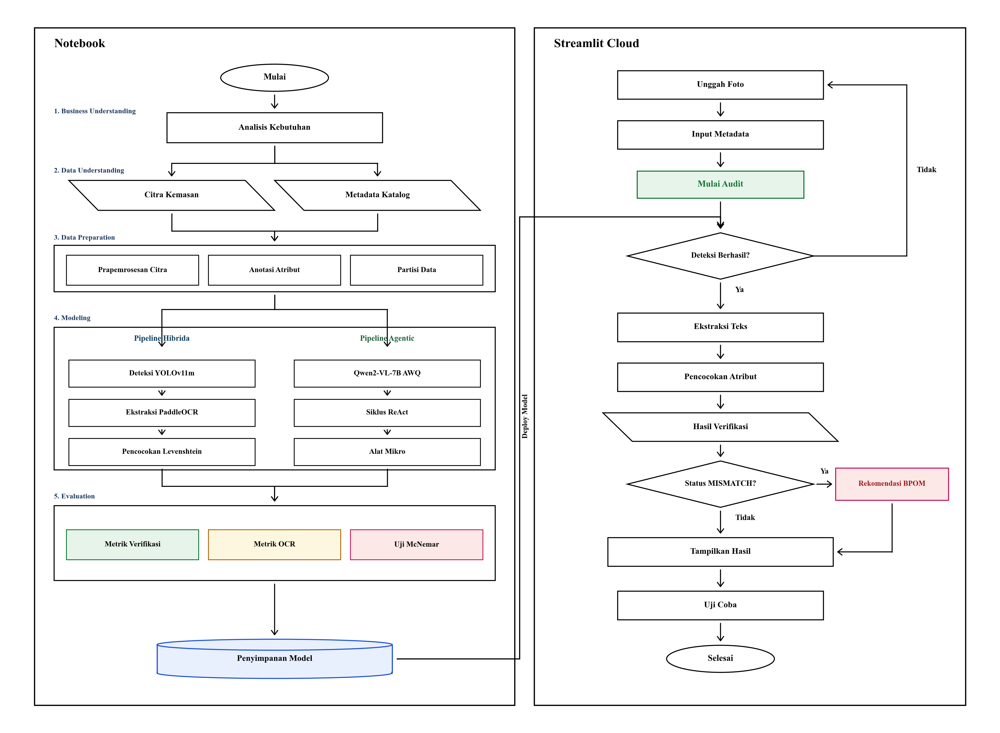

**Gambar 3.1 Alur Penelitian CRISP-DM**

Pada Gambar 3.1 diperlihatkan alur tahapan penelitian yang menerapkan metodologi CRISP-DM, dimulai dari tahap *Business Understanding*, *Data Understanding*, *Data Preparation*, *Modeling*, *Evaluation*, hingga tahap *Deployment*.

## 3.2 Objek Penelitian

Objek penelitian dalam penelitian ini adalah katalog produk kosmetik pada situs web Sociolla yang dikelola oleh PT Social Bella Indonesia. Sociolla merupakan platform niaga elektronik kecantikan dan perawatan diri di Indonesia yang menjual berbagai produk kosmetik dari merek lokal maupun internasional yang telah terdaftar di Badan Pengawas Obat dan Makanan atau BPOM. Setiap halaman produk pada katalog Sociolla menampilkan informasi berupa judul produk, nama merek, ukuran isi bersih, jenis sediaan, serta foto tampak depan kemasan fisik produk. Informasi tersebut menjadi acuan utama bagi pembeli saat memilih dan membeli produk.

Dalam penayangan produk di situs web, sering kali ditemukan perbedaan antara informasi teks yang ditulis oleh penjual dengan tulisan yang tertera pada gambar kemasan produk. Perbedaan informasi tersebut biasanya berupa kesalahan penulisan ukuran isi bersih, misalnya judul produk tertulis 50 ml tetapi pada gambar kemasan fisik tertera 30 ml atau 100 ml. Selain itu, terdapat kesalahan penulisan jenis sediaan produk, seperti judul produk tertulis pelembap padahal kemasan yang ditampilkan adalah sabun pembersih wajah, serta kesalahan pengetikan nama merek yang bercampur dengan nama varian produk. Perbedaan informasi ini dapat membingungkan pembeli dan berisiko melanggar aturan penandaan produk kosmetik dari BPOM serta Undang-Undang Perlindungan Konsumen.

Selama ini, proses pemeriksaan kesesuaian informasi katalog masih dilakukan secara manual oleh tim pemeriksa. Pemeriksaan manual ini membutuhkan waktu yang lama dan rentan terhadap kekeliruan, terutama karena jumlah produk yang harus diperiksa sangat banyak dan terus bertambah setiap hari. Oleh karena itu, penelitian ini menggunakan data katalog dari Sociolla untuk menguji sistem verifikasi otomatis berbasis visi komputer yang dapat mendeteksi perbedaan antara teks katalog dan gambar kemasan produk secara cepat dan tepat.

## 3.3 Data Penelitian

Data penelitian yang digunakan terdiri dari dua bentuk, yaitu data teks informasi katalog dan foto tampak depan kemasan produk beresolusi tinggi. Seluruh data diambil dari situs web Sociolla dalam rentang waktu tahun 2024 hingga 2026. Pembagian data dilakukan dengan memperhatikan pemisahan yang ketat agar tidak terjadi kebocoran data mengacu pada Kaufman dkk. (2012), serta setiap berkas foto diverifikasi menggunakan kode *hash* SHA-256 untuk memastikan data tidak mengalami perubahan.

### 3.3.1 Sumber Data

Data sekunder diperoleh dari situs web resmi Sociolla pada alamat sociolla.com. Pengumpulan data dilakukan menggunakan program *web scraping* berbasis Python pada kategori produk kosmetik yang terdaftar di BPOM. Proses pengambilan data diberi jeda waktu antar-permintaan agar tidak mengganggu kinerja server situs web dan memastikan seluruh teks maupun foto terunduh dengan lengkap.

### 3.3.2 Dataset Penelitian

Data yang berhasil dikumpulkan pada tahap awal berjumlah 5.490 produk. Seluruh foto produk kemudian diperiksa kualitasnya dengan batas ukuran resolusi minimal 640 × 640 piksel. Sebanyak 132 foto yang berkualitas rendah atau buram dihapus dari dataset karena tulisan pada kemasan produk tidak dapat dibaca oleh mata manusia maupun mesin pembaca teks OCR.

Setelah proses penyaringan selesai, diperoleh sebanyak 5.358 foto kemasan yang terbagi ke dalam tiga kategori produk:
1. **Perawatan Kulit**: 3.225 produk atau 60,19 persen, meliputi botol serum, toner, wadah pelembap, dan sabun pembersih wajah.
2. **Riasan Wajah**: 1.581 produk atau 29,51 persen, meliputi bedak padat, alas bedak, lipstik, dan perona pipi.
3. **Perawatan Rambut**: 552 produk atau 10,30 persen, meliputi botol sampo, kondisioner, tonik rambut, dan masker rambut.

Kumpulan data ini mencakup 267 merek kosmetik resmi. Contoh variasi bentuk dan kemasan produk pada dataset disajikan pada Gambar 3.2.

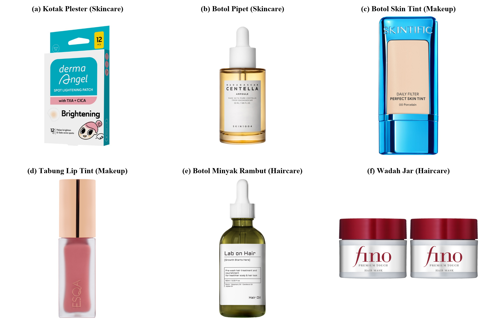

**Gambar 3.2 Variasi Bentuk Kemasan Produk**

Pada Gambar 3.2 disajikan variasi bentuk kemasan produk kosmetik dalam dataset, meliputi kotak plester (a), botol pipet (b), botol skin tint (c), tabung lip tint (d), botol minyak rambut (e), dan wadah jar (f).

### 3.3.3 Atribut Dataset

Dataset yang digunakan memuat beberapa kolom data yang berisi identitas produk, deskripsi katalog, jenis sediaan, serta tautan foto kemasan. Kolom-kolom ini menjadi sumber klaim yang akan dicocokkan dengan teks yang terbaca pada kemasan fisik produk. Rincian kolom data dijelaskan pada Tabel 3.1.

**Tabel 3.1 Atribut Data Katalog Kosmetik**

| No | Atribut Dataset | Tipe Data | Keterangan | Penggunaan dalam Sistem |
| :---: | :--- | :---: | :--- | :--- |
| 1 | `product_id` | String | Kode unik pengenal produk | Kunci utama identitas produk |
| 2 | `product_name` | String | Nama lengkap produk pada katalog | Sumber ekstraksi nama produk dan jenis sediaan |
| 3 | `brand` | String | Nama merek kosmetik | Klaim merek penjual |
| 4 | `netto` | String | Ukuran berat atau isi bersih produk | Klaim isi bersih penjual |
| 5 | `category` | String | Kategori besar produk (perawatan kulit, riasan, rambut) | Dasar pengelompokan data |
| 6 | `description` | Text | Penjelasan fungsi dan kegunaan kosmetik | Informasi pendukung katalog |
| 7 | `image_url` | String | Tautan unduhan foto kemasan | Sumber pengambilan foto produk |
| 8 | `image_path` | String | Lokasi penyimpanan lokal file foto | Masukan gambar untuk model visi komputer |

### 3.3.4 Pemetaan Atribut Verifikasi

Proses verifikasi katalog difokuskan pada tiga atribut utama, yaitu Merek, Isi Bersih, dan Bentuk Sediaan. Kolom data mentah dari situs web memiliki penulisan teks yang beragam, sehingga perlu disesuaikan ke dalam format standar sistem. Pemetaan atribut tersebut disajikan pada Tabel 3.2.

**Tabel 3.2 Pemetaan Atribut Dataset ke Atribut Verifikasi Katalog**

| Atribut Mentah Katalog | Atribut Standar Sistem | Format Standar Sistem | Target Pembacaan pada Kemasan |
| :--- | :--- | :--- | :--- |
| `brand` | `claimed_brand` | Huruf kapital | Tulisan logo atau nama merek pada kemasan |
| `netto` | `claimed_netto_val` dan `claimed_netto_unit` | Angka desimal dan satuan baku ml, g, atau oz | Angka ukuran dan satuan pada botol kemasan |
| `product_name` / `category` | `claimed_product_type` | Kamus standar 13 jenis sediaan kosmetik | Kata petunjuk fungsi atau bentuk produk |
| `image_path` | `visual_input_tensor` | Gambar RGB ukuran 640 × 640 piksel | Seluruh gambar tampak depan kemasan |

Hasil pemetaan atribut ini menjadi dasar bagi sistem untuk membandingkan informasi teks yang ada pada katalog penjual dengan tulisan fisik pada gambar kemasan produk.

## 3.4 Perangkat Keras

Perangkat keras yang digunakan dalam penelitian ini terdiri dari laptop pengembang untuk mengolah data dan menulis program, serta komputer server dengan kartu grafis GPU untuk melatih dan menjalankan model. Rincian perangkat keras disajikan pada Tabel 3.3.

**Tabel 3.3 Perangkat Keras**

| Komponen | Spesifikasi | Fungsi |
| :--- | :--- | :--- |
| **Laptop** | Dell Inspiron 15 3525 | Menulis program, mengolah gambar, dan menguji sistem |
| **Prosesor (CPU)** | AMD Ryzen 5 5500U, 6 Cores, 12 Threads, 2.10 GHz – 4.00 GHz | Memproses data dan menjalankan program |
| **Memori (RAM)** | 24 GB DDR4 | Menyimpan data sementara saat program berjalan |
| **Penyimpanan (Storage)** | SSD 512 GB internal dan SSD 1 TB eksternal | Menyimpan file dataset, kode program, dan hasil model |
| **Kartu Grafis Laptop** | AMD Radeon Graphics | Menampilkan antarmuka layar laptop |
| **Kartu Grafis Server (GPU)** | NVIDIA Tesla T4 16 GB (Kaggle) | Melatih model YOLOv11 dan menjalankan model Qwen2-VL |
| **Sistem Operasi** | Windows 11 dan Linux Ubuntu 22.04 | Sistem operasi untuk menjalankan perangkat lunak |

## 3.5 Perangkat Lunak

Perangkat lunak yang digunakan dalam penelitian ini mencakup sistem operasi, bahasa pemrograman, dan pustaka pendukung untuk mengolah data, melatih model, serta membuat tampilan web. Rincian perangkat lunak disajikan pada Tabel 3.4.

**Tabel 3.4 Perangkat Lunak**

| Perangkat Lunak | Versi | Fungsi |
| :--- | :---: | :--- |
| **Python** | 3.10.12 | Bahasa pemrograman untuk membuat program |
| **Ultralytics YOLOv11** | 11.0.0 | Melatih dan menguji model deteksi objek kemasan |
| **PaddleOCR** | 2.7.3 | Membaca teks tulisan pada kemasan |
| **Hugging Face Transformers** | 4.45.0 | Menjalankan model visi-bahasa Qwen2-VL |
| **AutoAWQ** | 0.2.6 | Memperkecil ukuran model agar lebih ringan dan cepat |
| **OpenCV** | 4.8.1 | Mengolah gambar dan memperbaiki kontras |
| **Pillow** | 10.1.0 | Memotong dan mengubah ukuran gambar |
| **Roboflow** | Versi Web | Menandai kotak label pada gambar kemasan |
| **Streamlit** | 1.39.0 | Membuat tampilan web untuk uji coba sistem |
| **Pandas dan NumPy** | 2.1.4 / 1.26.2 | Mengolah tabel data dan menghitung angka |
| **Scikit-Learn dan Statsmodels** | 1.3.2 / 0.14.0 | Membagi data dan menghitung uji statistik |
| **Visual Studio Code** | 1.95.0 | Menulis dan mengedit kode program |

## 3.6 Tahapan Penelitian

Penelitian ini dilaksanakan melalui enam tahapan terstruktur mengikuti metodologi CRISP-DM sebagaimana telah disajikan pada Gambar 3.1. Pelaksanaan setiap tahapan penelitian diuraikan secara rinci pada bagian berikut.

### 3.6.1 *Business Understanding*

Tahap *Business Understanding* bertujuan merumuskan permasalahan operasional pada pengelolaan katalog produk kosmetik dan menetapkan target luaran penelitian yang terukur. Pada tahap ini, diidentifikasi adanya perbedaan informasi antara teks yang dicantumkan penjual pada katalog situs web Sociolla dengan fakta yang tercetak pada kemasan fisik produk. Penayangan produk dalam jumlah besar tanpa verifikasi otomatis berisiko menimbulkan kesalahan informasi bagi pembeli dan ketidakpatuhan terhadap ketentuan penamaan produk.

Berdasarkan permasalahan tersebut, dirumuskan empat sasaran teknis penelitian:
1. Membangun alur kerja deteksi objek berbasis YOLOv11m dan pengenalan teks PaddleOCR PP-OCRv4 untuk membaca tiga atribut utama pada tampak depan kemasan produk, yaitu merek, isi bersih, dan tipe sediaan.
2. Mengembangkan alur kerja berbasis model visual bahasa Qwen2-VL-7B-Instruct menggunakan siklus penalaran bertahap untuk memeriksa teks label dan bentuk fisik wadah produk secara terarah.
3. Melakukan evaluasi komparatif pada data uji independen untuk mengukur akurasi verifikasi katalog, akurasi pembacaan karakter teks, penggunaan sumber daya komputasi, serta signifikansi perbedaan performa melalui uji statistik McNemar pada taraf nyata α = 0,05.
4. Menerapkan model terbaik ke dalam aplikasi dasbor web interaktif berbasis Streamlit yang dilengkapi fitur pemeriksaan produk dan pembuatan rekomendasi perbaikan judul katalog sesuai ketentuan BPOM.

### 3.6.2 *Data Understanding*

Tahap *Data Understanding* difokuskan pada pengumpulan, penelaahan awal, dan analisis karakteristik data katalog produk kosmetik Sociolla. Tahapan ini bertujuan mengenali kondisi visual foto kemasan dan memastikan kelengkapan data teks sebelum proses pemodelan dilakukan. Diagram alir pelaksanaan tahap *Data Understanding* disajikan pada Gambar 3.3.

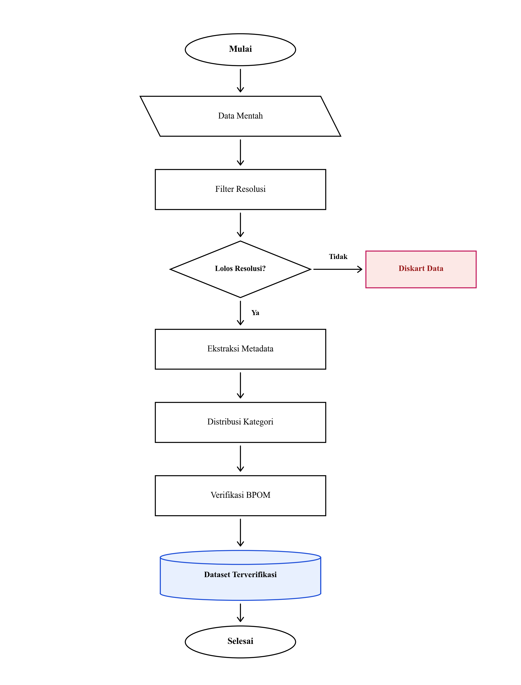

**Gambar 3.3 Alur Tahap *Data Understanding****

Pada Gambar 3.3 diperlihatkan alur pelaksanaan tahap *Data Understanding* yang mencakup lima kegiatan utama:

1. Pengumpulan Data Mentah: Mengunduh 5.490 data produk kosmetik dari situs web Sociolla yang mencakup foto kemasan tampak depan dan informasi teks katalog menggunakan program Python.
2. Pemeriksaan Resolusi: Memeriksa resolusi foto kemasan secara terprogram dengan batas ukuran minimal 640 × 640 piksel. Sebanyak 132 foto yang beresolusi di bawah standar dikeluarkan dari dataset agar tidak menurunkan kualitas pembacaan teks, sehingga diperoleh 5.358 foto kemasan yang siap diproses.
3. Pengambilan Data Katalog: Mengambil empat data penting dari katalog digital sebagai acuan pencocokan, yaitu nama merek, ukuran isi bersih, tipe sediaan produk, dan kelompok kategori.
4. Pengelompokan Kategori: Mengelompokkan data ke dalam tiga kategori utama, yaitu perawatan kulit sebanyak 3.225 produk atau 60,19%, riasan wajah sebanyak 1.581 produk atau 29,51%, dan perawatan rambut sebanyak 552 produk atau 10,30%.
5. Pemeriksaan Izin BPOM: Memeriksa keberadaan Nomor Izin Edar resmi berawalan kode NA pada setiap produk untuk memastikan data yang diteliti merupakan produk legal yang beredar secara resmi.

Berdasarkan hasil penelaahan data foto kemasan, ditemukan tiga karakteristik fisik yang menjadi tantangan dalam pengenalan visual:

1. Pantulan Cahaya: Sebagian kemasan menggunakan botol kaca bening atau plastik mengilap yang memantulkan cahaya lampu pemotretan sehingga sebagian teks tampak silau atau pudar.
2. Bentuk Kemasan Melengkung: Wadah kosmetik yang berbentuk tabung silinder menyebabkan teks pada sisi tepi botol tampak miring dan melengkung.
3. Ukuran Teks Sangat Kecil: Informasi ukuran isi bersih pada sebagian kemasan dicetak dengan huruf berukuran kecil pada bagian bawah botol.

### 3.6.3 *Data Preparation*

Tahap *Data Preparation* bertujuan mengolah foto kemasan dan informasi teks katalog agar siap digunakan pada proses pelatihan dan pengujian model. Diagram alir tahap *Data Preparation* disajikan pada Gambar 3.4.

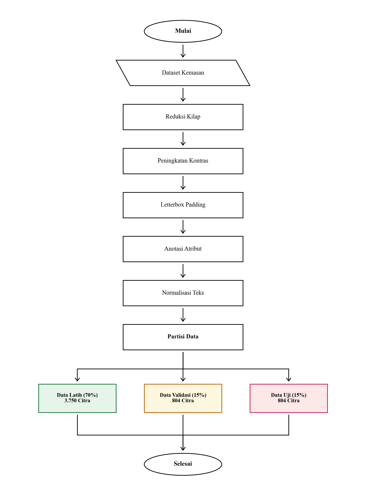

**Gambar 3.4 Alur Tahap *Data Preparation****

Pada Gambar 3.4 diperlihatkan alur pelaksanaan tahap *Data Preparation* yang mencakup tiga tahapan kerja utama, yaitu perbaikan kualitas foto kemasan, penandaan area tulisan, dan pembagian data penelitian:

1. Prapemrosesan Citra Digital

Untuk meningkatkan kejelasan teks pada foto kemasan, dilakukan tiga tahapan perbaikan citra:
- Pengurangan Pantulan Cahaya: Mengonversi citra ke ruang warna hue, lightness, dan saturation atau HLS, mendeteksi area dengan saturasi rendah dan kecerahan tinggi, kemudian memperbaiki area tersebut menggunakan metode penambalan citra Navier-Stokes.
- Peningkatan Kontras Adaptif: Menerapkan metode Contrast Limited Adaptive Histogram Equalization atau CLAHE pada kanal pencahayaan ruang warna CIE L*a*b* dengan batas pemangkasan kontras 2,0 dan ukuran kisi ubin 8 × 8 untuk mempertegas tulisan tanpa memunculkan derau berlebih.
- Penyesuaian Ukuran Kanvas: Mengubah ukuran foto menjadi bujur sangkar 640 × 640 piksel dengan mempertahankan proporsi bentuk asli kemasan melalui penambahan batas warna abu-abu netral pada sisi yang kosong.

2. Pelabelan Anotasi Kotak Pembatas

Sebanyak 5.358 foto kemasan diberi label kotak pembatas berupa koordinat posisi horizontal dan vertikal menggunakan platform Roboflow. Anotasi dilakukan untuk tiga kelas atribut, yaitu merek sebagai kelas 0, isi bersih sebagai kelas 1, dan tipe produk sebagai kelas 2. Contoh hasil pelabelan kotak pembatas disajikan pada Gambar 3.5.

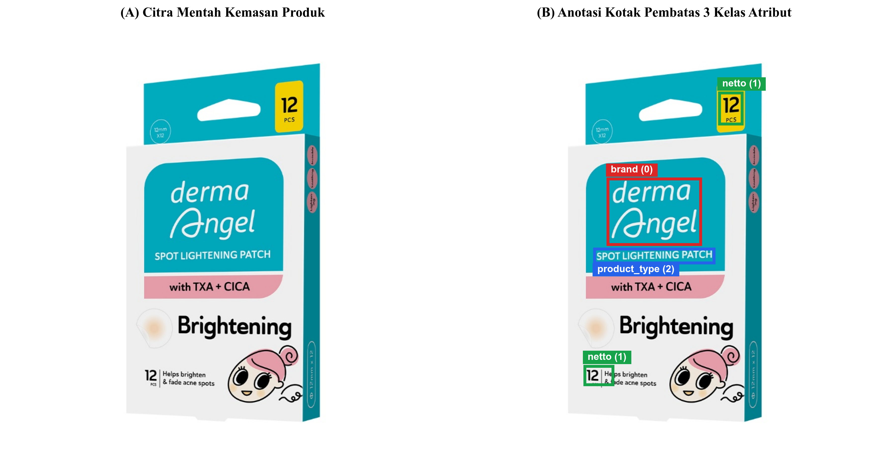

**Gambar 3.5 Anotasi Kotak Pembatas Atribut**

Pada Gambar 3.5 diperlihatkan contoh foto kemasan produk pada bagian A dan hasil penandaan kotak pembatas pada bagian B, dengan warna merah menandai posisi merek, warna hijau menandai isi bersih, dan warna biru menandai tipe sediaan produk.

3. Pembagian Partisi Dataset

Untuk mencegah kebocoran informasi visual dari merek yang sama antara data latih dan data uji, pembagian data dilakukan menggunakan metode pembagian kelompok bertingkat berdasarkan merek atau stratified group split by brand dengan perbandingan 70:15:15. Seluruh produk dari satu merek dikelompokkan ke dalam satu bagian data saja. Rincian pembagian partisi dataset disajikan pada Tabel 3.5.

**Tabel 3.5 Pembagian Partisi Dataset Berdasarkan Merek**

| Partisi Data | Proporsi | Jumlah Produk | Jumlah Merek | Fungsi Penggunaan |
| :--- | :---: | :---: | :---: | :--- |
| **Data Latih** | 70% | 3.750 | 187 | Melatih bobot deteksi objek model YOLOv11m |
| **Data Validasi** | 15% | 804 | 40 | Menyetel parameter pelatihan dan memantau overfitting |
| **Data Uji** | 15% | 804 | 40 | Menguji performa akhir kedua model secara independen |
| **Total** | 100% | 5.358 | 267 | Kumpulan data keseluruhan penelitian |

### 3.6.4 *Modeling*

Tahap *Modeling* merupakan inti pembuatan sistem verifikasi pada penelitian ini. Dua pendekatan kecerdasan buatan dirancang dan diuji secara berdampingan untuk memeriksa kesesuaian antara informasi katalog dengan teks fisik pada kemasan produk. Diagram alir tahap *Modeling* disajikan pada Gambar 3.6.

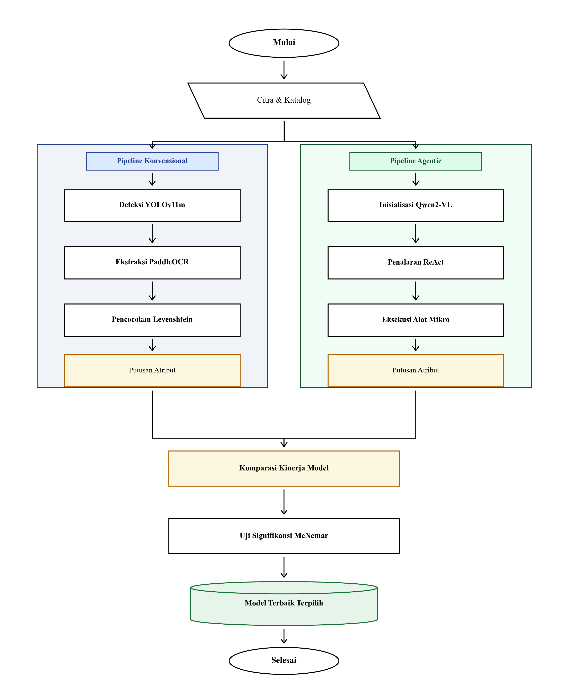

**Gambar 3.6 Alur Tahap *Modeling* Komparatif**

Pada Gambar 3.6 diperlihatkan alur kerja tahap *Modeling* yang membandingkan model hibrida YOLOv11m dan PaddleOCR dengan model visual bahasa Qwen2-VL dalam membaca dan memverifikasi data produk:

1. Alur Model Hibrida Deteksi dan OCR (YOLOv11m dan PaddleOCR PP-OCRv4)

Pendekatan ini bekerja secara berurutan dalam dua langkah utama:
- Deteksi Posisi Atribut: Model YOLOv11m menerima masukan foto kemasan berukuran 640 × 640 piksel dan menentukan lokasi kotak pembatas untuk atribut merek, isi bersih, dan tipe produk dengan batas keyakinan minimal 0,25. Konfigurasi parameter pelatihan model YOLOv11m dirangkum pada Tabel 3.6.
- Pemotongan Area Teks: Kotak pembatas hasil deteksi diperluas sebesar 10% hingga 15% pada setiap sisinya agar huruf atau angka di tepi kemasan tidak terpotong saat dipisahkan dari foto utama.
- Pembacaan Karakter Teks: Potongan gambar area atribut dibaca oleh PaddleOCR PP-OCRv4. Algoritma DBNet++ mendeteksi batas area tulisan, kemudian algoritma rekognisi SVTR-LCNet membaca deretan huruf dan angka.

**Tabel 3.6 Parameter Pelatihan Model YOLOv11m**

| Hyperparameter | Value | Keterangan Fungsional |
| :--- | :---: | :--- |
| **`imgsz`** | 640 × 640 | Resolusi dimensi citra masukan pelatihan |
| **`epochs`** | 100 | Jumlah siklus iterasi pelatihan model |
| **`batch_size`** | 16 | Jumlah sampel citra per iterasi gradien |
| **`optimizer`** | AdamW | Algoritma optimasi pembaruan bobot |
| **`lr0`** | 0,001 | Laju pembelajaran awal (*initial learning rate*) |
| **`lrf`** | 0,01 | Rasio fraksi laju pembelajaran akhir (*final lr*) |
| **`momentum`** | 0,937 | Faktor momentum akselerasi gradien |
| **`weight_decay`** | 0,0005 | Koefisien penalti regulasi bobot jaringan |
| **`warmup_epochs`** | 3 | Siklus pemanasan penyesuaian gradien awal |
| **`patience`** | 15 | Batas penghentian dini (*early stopping*) |
| **`conf`** | 0,25 | Ambang batas keyakinan minimum deteksi kotak |
| **`box`** | 7,5 | Bobot pengali fungsi rugi kotak (*box loss gain*) |
| **`cls`** | 0,5 | Bobot pengali fungsi rugi kelas (*cls loss gain*) |

2. Alur Model Bahasa Visual (Qwen2-VL-7B-Instruct)

Pendekatan ini memanfaatkan kemampuan model fondasi bahasa visual yang memproses foto pada rasio aspek asli dan dipercepat menggunakan kuantisasi 4-bit AWQ:
- Siklus Penalaran Bertahap ReAct: Model bekerja melalui perulangan pemikiran untuk menganalisis kondisi gambar, tindakan untuk menjalankan perintah inspeksi, dan observasi untuk menerima hasil tindakan dengan batas maksimal 5 langkah perulangan.
- Penggunaan Fungsi Bantuan Mikro: Model dibekali tiga fungsi terprogram, yaitu pemotongan area fokus kemasan resolusi penuh untuk memperjelas teks kecil, penajaman kontras adaptif untuk area tulisan yang pudar atau terkena silau, dan penetapan putusan akhir berupa data berformat JSON.

Rincian pengaturan konfigurasi untuk model Qwen2-VL-7B-Instruct dan PaddleOCR PP-OCRv4 disajikan pada Tabel 3.7.

**Tabel 3.7 Konfigurasi Model Qwen2-VL dan PaddleOCR**

| Model | Parameter | Value | Keterangan Fungsional |
| :--- | :--- | :---: | :--- |
| **Qwen2-VL-7B-Instruct** | **Quantization** | AWQ W4A16 | Kuantisasi 4-bit untuk efisiensi memori GPU |
| | **Group Size** | 128 | Ukuran blok kuantisasi bobot model |
| | **Max New Tokens** | 512 | Batas maksimum panjang teks jawaban |
| | **Temperature** | 0,0 | Pengaturan luaran deterministik bebas variasi |
| | **Top-p** | 1,0 | Penarikan probabilitas distribusi penuh |
| | **Max Context Length** | 4.096 | Batas kapasitas jendela memori token visual teks |
| | **Max ReAct Steps** | 5 | Batas iterasi siklus tindakan inspeksi visual |
| **PaddleOCR PP-OCRv4** | **Detection Algorithm** | DBNet++ | Algoritma deteksi batas poligon area teks |
| | **`det_db_thresh`** | 0,3 | Ambang batas binarisasi piksel segmentasi teks |
| | **`det_db_box_thresh`** | 0,6 | Ambang batas penyaringan skor kontur kotak |
| | **`det_db_unclip_ratio`** | 1,5 | Rasio ekspansi poligon area pembacaan teks |
| | **`use_angle_cls`** | True | Klasifikasi dan koreksi orientasi kemiringan teks |
| | **Recognition Algorithm** | SVTR-LCNet | Algoritma pengenalan deretan karakter teks |
| | **`rec_batch_num`** | 6 | Jumlah potongan teks per batch inferensi OCR |
| | **Recognition Threshold** | 0,50 | Batas skor keyakinan kelulusan hasil OCR |
| | **RoI Expansion Margin** | 12% | Margin adaptif perluasan area deteksi sebelum OCR |

3. Modul Pencocokan Teks Katalog

Hasil pembacaan teks dari kedua model dicocokkan dengan informasi katalog menggunakan aturan yang sama:
- Verifikasi Merek: Menggunakan perhitungan kesamaan teks Levenshtein ternormalisasi dengan batas kesamaan minimal 0,85 untuk mentoleransi kesalahan ketik kecil.
- Verifikasi Isi Bersih: Angka dan satuan diekstraksi, disetarakan ke satuan standar metrik (seperti 1 ons cairan disetarakan ke 29,57 ml), lalu dicocokkan dengan toleransi selisih maksimal 1%.
- Verifikasi Tipe Produk: Dicocokkan ke dalam daftar 13 nama sediaan kosmetik standar menggunakan pencocokan kata kunci terarah.

### 3.6.5 *Evaluation*

Tahap *Evaluation* bertujuan mengukur performa kedua pendekatan model secara objektif pada 804 sampel data uji independen. Diagram alir tahap *Evaluation* disajikan pada Gambar 3.7.

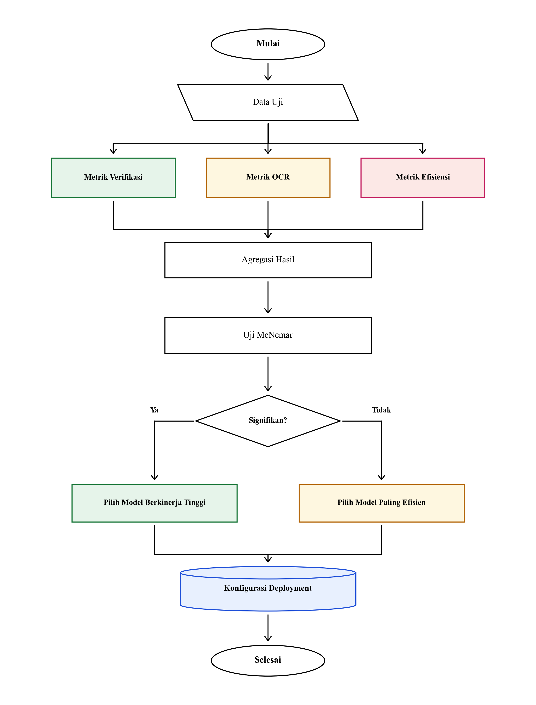

**Gambar 3.7 Alur Tahap *Evaluation* Komparatif**

Pada Gambar 3.7 diperlihatkan alur kerja tahap *Evaluation* yang menguji performa kedua model melalui empat aspek pengukuran:

1. Metrik Verifikasi Kesesuaian Katalog

Pengukuran kemampuan model dalam menentukan status kesesuaian katalog dihitung menggunakan metrik akurasi, presisi, recall, dan F1-score:

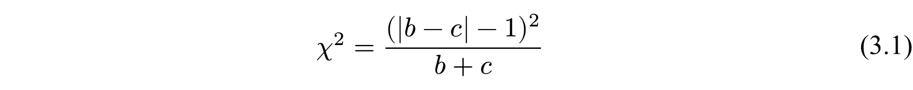

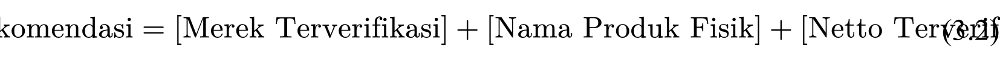

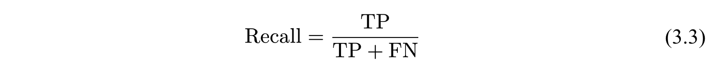

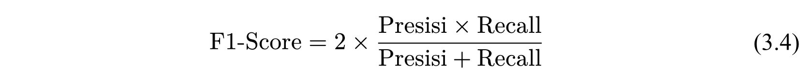

Keterangan:
- TP (True Positive): Jumlah produk berstatus sesuai yang diprediksi benar oleh model.
- TN (True Negative): Jumlah produk berstatus tidak sesuai yang diprediksi benar oleh model.
- FP (False Positive): Jumlah produk yang sebenarnya tidak sesuai tetapi diprediksi sesuai.
- FN (False Negative): Jumlah produk yang sebenarnya sesuai tetapi diprediksi tidak sesuai.

2. Metrik Pembacaan Teks Karakter

Tingkat kesalahan pembacaan teks pada kemasan diukur menggunakan Character Error Rate atau CER dan Word Error Rate atau WER:

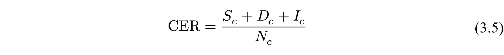

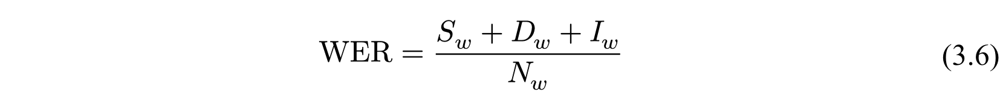

Keterangan:
- S_c dan S_w: Jumlah karakter atau kata yang tertukar (substitusi).
- D_c dan D_w: Jumlah karakter atau kata yang terhapus atau tidak terbaca (penghapusan).
- I_c dan I_w: Jumlah karakter atau kata tambahan yang salah terbaca (penyisipan).
- N_c dan N_w: Jumlah total karakter atau kata pada teks acuan kemasan fisik.

Tingkat kesamaan teks merek dan tipe sediaan dihitung menggunakan rumus Normalized Levenshtein Similarity atau NLS:

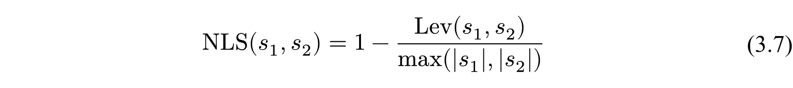

dengan Lev(s_1, s_2) menyatakan jarak edit minimum antara teks katalog s₁ dan teks hasil baca kemasan s₂.

3. Pengukuran Efisiensi Sumber Daya

Penggunaan sumber daya komputasi diukur berdasarkan:
- Rata-rata waktu inferensi per sampel dalam satuan milidetik atau detik.
- Penggunaan memori GPU puncak dalam satuan gigabita (GB).

4. Uji Signifikansi Statistik McNemar

Untuk membuktikan apakah perbedaan ketepatan klasifikasi antara model hibrida dan model visual bahasa berbeda secara nyata dan bukan kebetulan acak, dilakukan uji statistik non-parametrik McNemar pada pasangan data uji yang sama. Uji ini menggunakan tabel kontingensi 2 × 2 sebagaimana disajikan pada Tabel 3.8.

**Tabel 3.8 Matriks Kontingensi Uji McNemar**

| Performa Model Hibrida | Model Qwen2-VL Benar | Model Qwen2-VL Salah | Total |
| :--- | :---: | :---: | :---: |
| **Model Hibrida Benar** | a | b | a + b |
| **Model Hibrida Salah** | c | d | c + d |
| **Total** | a + c | b + d | N = 804 |

Keterangan:
- a: Jumlah sampel yang dijawab benar oleh kedua model.
- b: Jumlah sampel yang dijawab benar oleh model hibrida tetapi dijawab salah oleh model Qwen2-VL.
- c: Jumlah sampel yang dijawab salah oleh model hibrida tetapi dijawab benar oleh model Qwen2-VL.
- d: Jumlah sampel yang dijawab salah oleh kedua model.

Nilai statistik uji chi-kuadrat dihitung menggunakan koreksi kontinuitas Edwards pada taraf signifikansi α = 0,05:

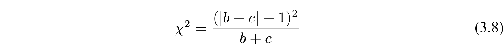

Jika nilai chi^2 hitung lebih besar dari nilai kritis tabel chi-kuadrat dengan derajat bebas 1 (χ²(0,05; 1) = 3,841) atau nilai p < 0,05, maka terdapat perbedaan performa yang signifikan antara kedua model.

### 3.6.6 *Deployment*

Tahap *Deployment* merupakan realisasi model ke dalam lingkungan operasional berupa aplikasi dasbor web interaktif berbasis Streamlit. Berbeda dengan tahap *Modeling* dan *Evaluation* yang membandingkan kedua model secara bersamaan, pada aplikasi operasional hanya diterapkan satu model terbaik hasil pengujian. Penerapan model tunggal terbaik bertujuan menjaga efisiensi waktu pemrosesan, mencegah pemakaian memori berlebih, dan menekan biaya sewa peladen komputasi. Diagram alir cara kerja aplikasi dasbor disajikan pada Gambar 3.8.

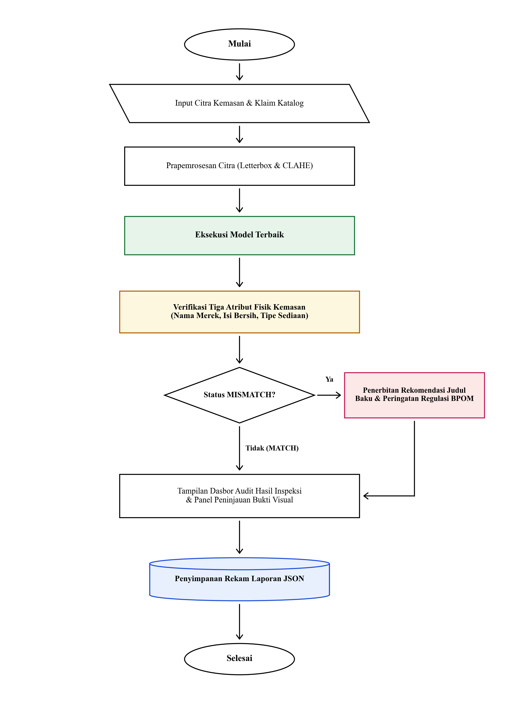

**Gambar 3.8 Alur Kerja Aplikasi Tahap *Deployment***

Pada Gambar 3.8 diperlihatkan cara kerja aplikasi pada tahap *Deployment*. Pengguna memasukkan foto kemasan dan data teks produk dari katalog. Sistem kemudian menyesuaikan ukuran foto, memproses foto menggunakan model terbaik untuk membaca merek, isi bersih, dan tipe sediaan, lalu memeriksa kesesuaian informasi tersebut. Jika ditemukan ketidaksesuaian, sistem menampilkan saran perbaikan judul produk sesuai aturan BPOM. Seluruh hasil pemeriksaan dapat disimpan dalam format berkas JSON.

Identitas visual aplikasi dirancang dengan logo dan ikon web sebagaimana disajikan pada Gambar 3.9.

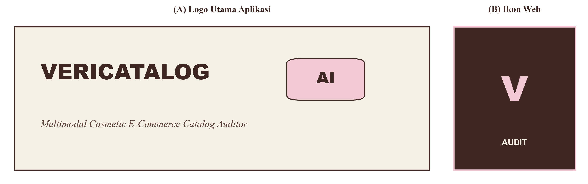

**Gambar 3.9 Logo dan Ikon Aplikasi**

Pada Gambar 3.9 ditampilkan rancangan logo dan ikon aplikasi yang digunakan pada bagian atas halaman dan bilah peramban sistem pemeriksaan produk.

Tampilan antarmuka dasbor dirancang menggunakan tiga warna utama untuk memberikan kenyamanan bagi pengguna sebagaimana dirangkum pada Tabel 3.9.

**Tabel 3.9 Palet Warna Desain Antarmuka Aplikasi**

| Peran Desain UI | Kode Hex | Nama Warna | Fungsi Penggunaan pada Aplikasi |
| :--- | :---: | :---: | :--- |
| **Warna Utama** | `#3E2723` | Cokelat Kopi | Digunakan untuk judul, teks utama, garis batas elemen, dan tombol aksi audit agar tulisan mudah dibaca dengan jelas |
| **Warna Aksen** | `#F4C9D6` | Merah Muda Lembut | Digunakan untuk kartu penyorotan atribut, tanda status tidak sesuai, dan wadah kartu rekomendasi perbaikan judul katalog |
| **Latar Belakang** | `#F5F0E6` | Krem Gading | Digunakan sebagai warna dasar latar aplikasi agar tampilan nyaman dilihat saat pemeriksaan berlangsung lama |

Antarmuka aplikasi dasbor terbagi ke dalam empat bagian tampilan utama:

1. Masukan Data dan Pemilihan Produk: Menyediakan formulir untuk memilih sampel uji dari katalog atau mengunggah foto kemasan baru beserta pengisian informasi teks produk, seperti disajikan pada Gambar 3.10.

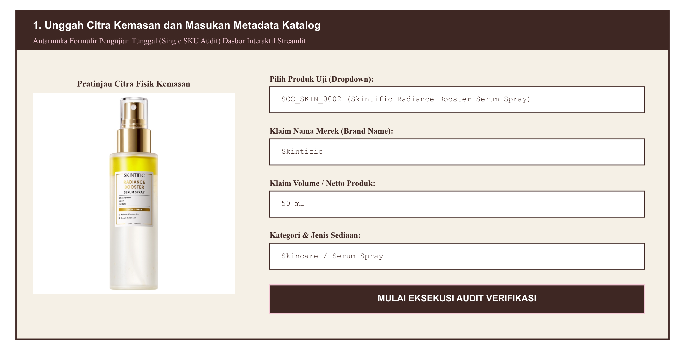

**Gambar 3.10 Tampilan Formulir Masukan Data Produk**

Pada Gambar 3.10 ditampilkan halaman formulir yang memungkinkan pengguna memilih produk yang telah terdaftar di katalog atau mengunggah foto kemasan dan data produk baru secara mandiri.

2. Panel Pemeriksaan Model Terbaik: Menampilkan hasil deteksi posisi tulisan pada foto kemasan, tabel perbandingan atribut katalog terhadap fakta fisik, waktu pemrosesan, dan data luaran format JSON, seperti disajikan pada Gambar 3.11.

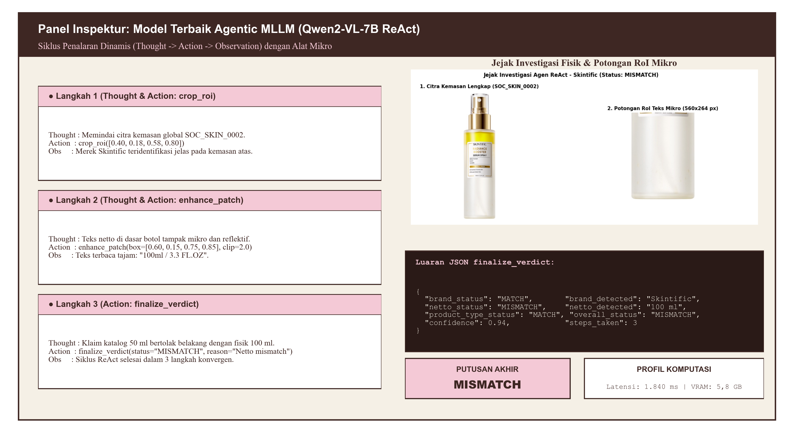

**Gambar 3.11 Tampilan Panel Pemeriksaan Model**

Pada Gambar 3.11 diperlihatkan tampilan panel pemeriksaan yang menyajikan letak kotak tulisan hasil deteksi pada kemasan, tabel kesesuaian tiap informasi produk, dan lama waktu pemrosesan foto.

3. Panel Peninjauan Hasil Benchmark: Menyajikan ringkasan hasil evaluasi komparatif kedua model pada 804 sampel uji, termasuk tabel matriks kontingensi uji McNemar, seperti disajikan pada Gambar 3.12.

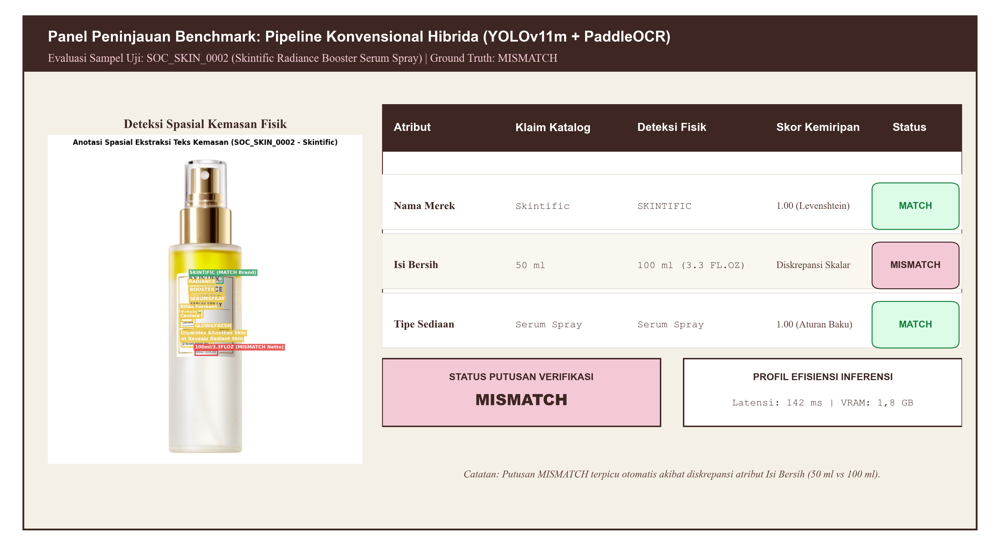

**Gambar 3.12 Tampilan Panel Perbandingan Model**

Pada Gambar 3.12 diperlihatkan halaman perbandingan yang menyajikan ringkasan nilai akurasi, presisi, recall, F1-score, serta tabel uji statistik McNemar antara kedua model.

4. Bilah Navigasi Samping: Memuat menu perpindahan antarmuka, status koneksi peladen, dan pemantauan penggunaan memori sistem, seperti disajikan pada Gambar 3.13.

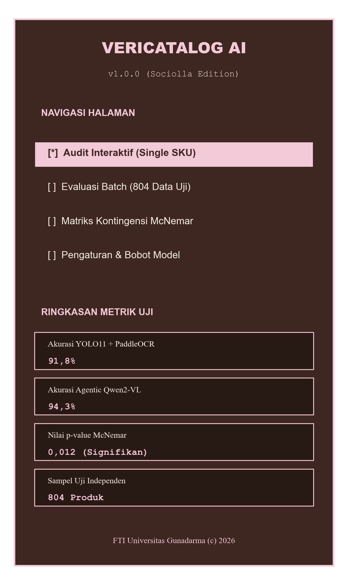

**Gambar 3.13 Tampilan Menu Navigasi Samping**

Pada Gambar 3.13 ditampilkan menu navigasi samping yang memuat pilihan halaman pemeriksaan, status kesiapan server, dan pemantauan penggunaan memori komputer.

Penetapan status akhir verifikasi katalog ditentukan berdasarkan aturan logika pada Tabel 3.10.

**Tabel 3.10 Aturan Putusan Verifikasi Katalog**

| Kondisi Tiga Atribut Fisik | Status Putusan | Tindakan Operasional Sistem |
| :--- | :---: | :--- |
| Skor merek ≥ 0,85, selisih netto ≤ 1%, dan tipe sediaan sesuai | **MATCH** | Informasi katalog dinyatakan sesuai dengan fisik kemasan dan diberi tanda centang hijau |
| Salah satu atau lebih atribut memiliki nilai yang berbeda | **MISMATCH** | Diterbitkan peringatan merah dan kartu rekomendasi perbaikan judul katalog |
| Teks pada kemasan tidak terbaca atau foto buram | **UNVERIFIED** | Diterbitkan pemberitahuan kuning untuk dilakukan pemeriksaan manual oleh petugas |

### 3.6.7 *Managerial Recommendation*

Setelah status verifikasi ditetapkan pada tahap *Deployment*, sistem menyusun rekomendasi perbaikan berbasis aturan terstruktur bagi produk yang berstatus MISMATCH. Sistem tidak menghasilkan teks bebas secara acak, melainkan menyusun judul rekomendasi baru mengikuti susunan baku:

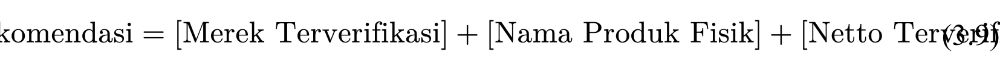

Susunan judul tersebut disertai penjelasan batas pemeriksaan bahwa sistem ini memverifikasi atribut identitas pada tampak depan kemasan fisik, sedangkan keabsahan nomor izin edar BPOM dan komposisi lengkap pada label belakang tetap memerlukan pengecekan dokumen oleh tim penjaminan mutu. Contoh rancangan rekomendasi perbaikan judul disajikan pada Tabel 3.11.

**Tabel 3.11 Template Rekomendasi Perbaikan Judul Katalog**

| Status Putusan | Bentuk Perbedaan Informasi | Contoh Rekomendasi Judul | Tindakan Perbaikan pada Sistem |
| :---: | :--- | :--- | :--- |
| **MISMATCH** | Perbedaan angka isi bersih (klaim 50 ml, fisik tercetak 100 ml) | `[{Merek}] {Nama Produk} [{Netto Fisik Terverifikasi}]` | Mengubah angka isi bersih pada data katalog mengikuti teks tercetak pada botol kemasan |
| **MISMATCH** | Kesalahan penulisan nama merek pada katalog | `[{Merek Fisik Terverifikasi}] {Nama Produk} {Netto}` | Memperbaiki ejaan nama merek pada katalog dan filter pencarian produk |
| **MISMATCH** | Perbedaan tipe sediaan (klaim pelembap, fisik sabun cuci muka) | `[{Merek}] {Nama Sediaan Fisik} {Netto}` | Mengubah kategori sediaan produk ke kelompok etalase yang sesuai |
| **MATCH** | Seluruh atribut terkonfirmasi sesuai | *Tidak memerlukan perbaikan judul* | Mempertahankan data katalog produk dan menampilkan tanda lulus verifikasi |

Tampilan kartu rekomendasi perbaikan judul dan catatan batas pemeriksaan BPOM yang ditampilkan pada dasbor disajikan pada Gambar 3.14.

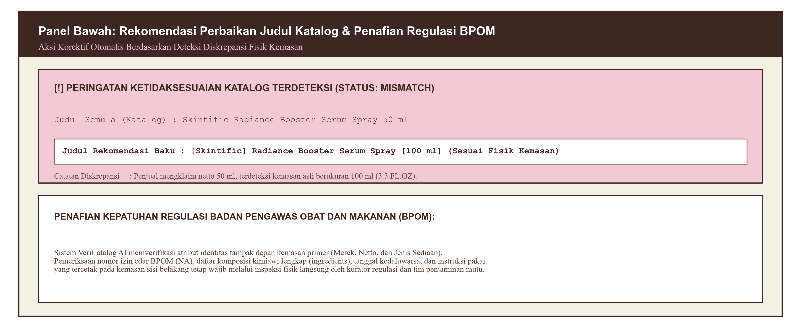

**Gambar 3.14 Tampilan Saran Perbaikan Judul Produk**

Pada Gambar 3.14 disajikan kartu pemberitahuan yang menampilkan perbandingan antara judul lama pada katalog dengan saran judul baru berdasarkan teks pada kemasan fisik, disertai catatan penjelasan batas pemeriksaan sistem.

## 3.7 Jadwal Penelitian

Pelaksanaan penelitian ini direncanakan berlangsung selama empat bulan, terhitung mulai bulan Oktober 2026 hingga Januari 2027. Jadwal ini mencakup persiapan perangkat kerja, penulisan naskah skripsi bab demi bab, implementasi sistem, pengujian model komparatif, serta konsultasi dan revisi naskah secara berkala. Matriks jadwal pelaksanaan penelitian disajikan pada Gambar 3.15.

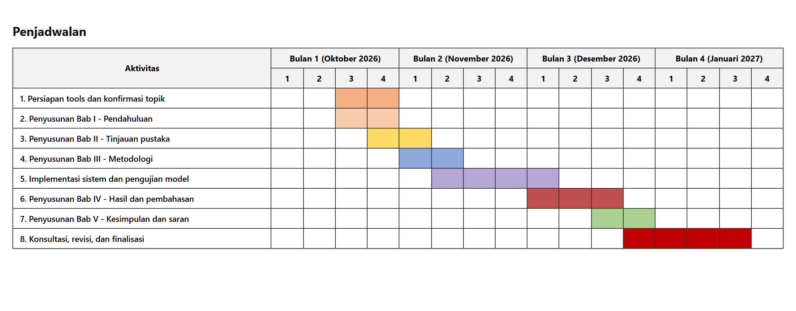

**Gambar 3.15 Jadwal Pelaksanaan Penelitian**

Pada Gambar 3.15 diperlihatkan jadwal pelaksanaan penelitian mingguan yang mencakup delapan kegiatan utama, mulai dari persiapan alat dan penentuan topik, penyusunan proposal dan metodologi, implementasi dan pengujian sistem, hingga penyelesaian naskah skripsi dan bimbingan akhir.
